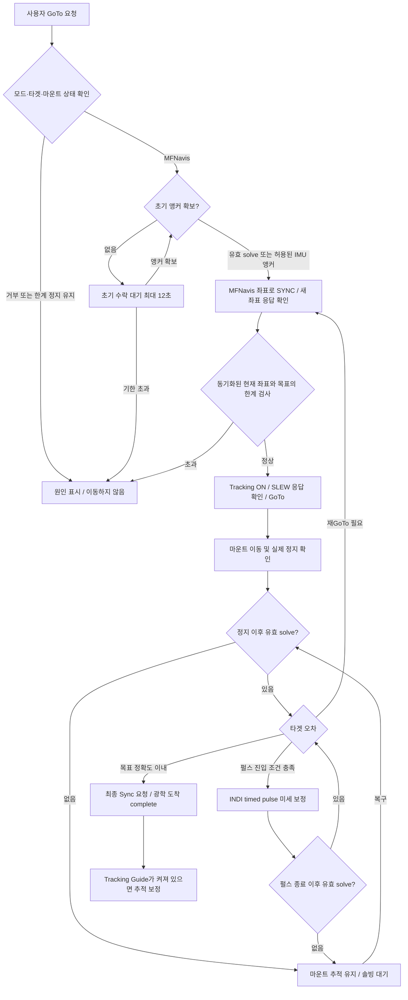
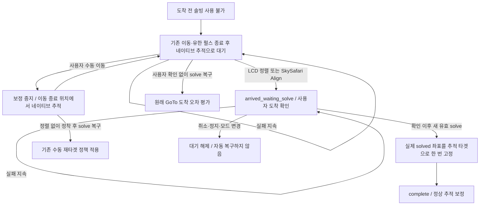
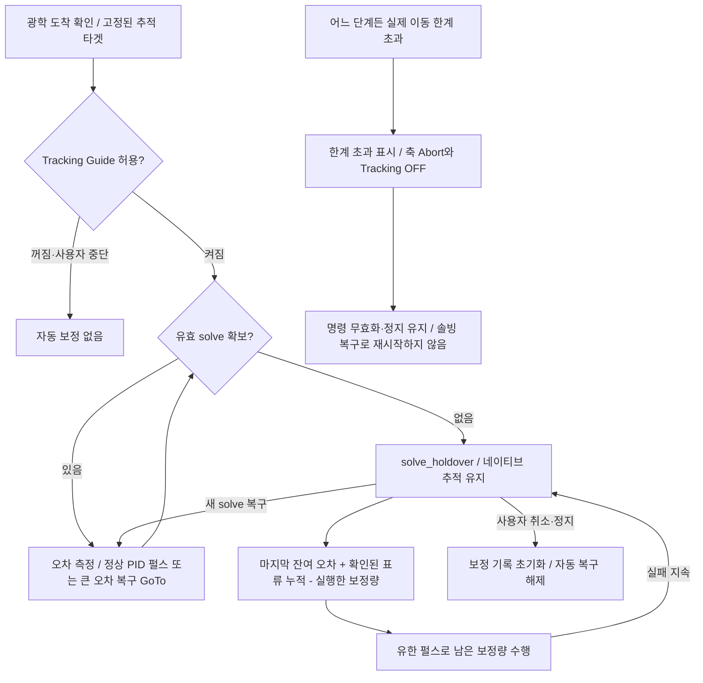

# MFNavis 마운트 제어와 GoTo·보정

기준: 2026-10-10 작업 트리. GoTo 시작, 도착 확인, 솔빙 소실 대기, 추적 보정,
사용자 정렬·취소·정지, 이동 한계 정지를 한 문서에서 관리한다.

## 소유권과 연결

`main.py`가 생성한 GoTo/Guide 서비스는 사용자 의도와 상태 전환을 관리하고,
`mountcontrol_indi.py`는 INDI 연결·명령 전송·상태 수집·실제 정지를 담당한다.
LCD, 웹, SkySafari는 같은 명령 경로를 사용한다. 큐에 넣은 명령과 드라이버의
수락 응답, 물리 이동 완료, 광학 도착을 서로 구분한다.

| GoTo Type | 동작 |
|---|---|
| `off` | GoTo 거부 |
| `indi_mount` | 네이티브 마운트 GoTo |
| `mfnavis` | 광학 앵커·검증된 Sync+GoTo·도착 확인·보정 상태기계 |

INDI Web Manager는 `8624`, INDI 서버 기본 포트는 `7624`다.
설치 후 웹 INDI 화면에서 서버·장치·Serial/Ethernet 전송을 설정하고,
실제 연결 상태와 위치·시각을 확인한다. Serial Auto와 재연결은
[연결 문서](connectivity_ko.md), 다중 정렬과 백레시는 [정렬 문서](alignment_ko.md),
선택형 smooth/영상 추적은 [추적 문서](tracking_ko.md)를 따른다.

## 2026-10-10 GoTo 시작부터 추적 보정까지 검증한 설계

이 절은 현재 작업 트리의 `indi_goto_guide_service.py`, `mountcontrol_indi.py`,
`guide_holdover.py`, `mount_motion_limits.py`와 자동 테스트를 대조한 기준이다.
이 문서를 현재 동작의 기준으로 사용한다. 과거 설계는 별도의 주제별 이력에 보관한다.
검증 범위는 **MFNavis 기본 GoTo/Tracking Guide**다. `indi_mount`는 네이티브
GoTo만 수행하며 `off`는 GoTo를 거부한다. 선택 기능인 smooth tracking은 별도
제어권·광학 품질 정책을 사용한다. 이동 한계 인터록은 smooth timed pulse에도 적용한다.

### 처리 계층과 판정 기준

| 계층 | 역할 | 다음 단계로 넘어가는 증거 |
|---|---|---|
| LCD·웹·SkySafari | 타겟, GoTo, 정렬, 수동 이동, 취소·정지 요청 | 큐에 사용자 의도를 전달 |
| GoTo/Guide 서비스 | 초기 이동·도착·추적·복구 상태 전환 | 최근 마운트 상태와 해당 이동 이후 촬영된 유효 solve |
| 마운트 실행기 | SYNC/GoTo, 가이드 펄스, 실제 한계 검사와 정지 | 현재 연결의 새로운 INDI 응답, 이동 상태, 펄스 종료 시각 |
| `GuideHoldover` | 마지막 측정 오차·실행한 보정량·확인된 표류 속도 기록 | 관측과 추정을 구분하고 같은 오차를 중복 누적하지 않음 |

마운트가 멈췄다는 것과 광학적으로 타겟에 도착했다는 것은 별개다.
`goto_completed_wall`은 마운트 정지 확인 시각이며, 도착 판정에는 그 이후의
solve가 필요하다. 광학 기준은 `pointing.aligned.solve`이고,
IMU로 진행한 `pointing.aligned.estimate`나 마운트 좌표를 새 solve로 취급하지 않는다.
정밀 보정 단계는 유효한 최근 성공 프레임을 계속 사용할 수 있지만, 이미 소비한
프레임으로 PID를 다시 실행하거나 펄스 종료 전 프레임으로 최종 도착을 확정하지 않는다.

### GoTo 시작과 도착 판정



1. 새 GoTo는 이전 도착·복구·보정 횟수를 초기화한다. 초기 IMU 앵커는 기존
   설정과 유효성 조건을 만족할 때만 허용한다. **초기 수락 대기 12초**와
   **이미 수락한 GoTo 중 솔빙 대기**는 다르다. 후자에는 만료 시간이 없다.
2. `sync_and_goto`는 현재 연결에서 새 `ON_COORD_SET=SYNC` 응답 → 요청과
   일치하는 좌표 응답 → 동기화 좌표와 목표의 한계 검사 → Tracking ON →
   `ON_COORD_SET=SLEW` 응답을 확인한 뒤 GoTo를 보낸다.
   이전 캐시나 단순 송신 성공만으로 다음 단계를 진행하지 않는다.
   MFNavis GoTo·IMU 폴백·추적 복구는 동기화 전의 마운트 좌표로 한계를
   판정하지 않는다. 컨트롤러가 보고한 한계 오류와 이미 잠긴 정지는 계속 적용한다.
3. 실행기는 INDI Busy·OnStep 완료·좌표 안정화를 확인한다. 검증된 빠른 정지는
   1초, 일반 경로는 2.5초 안정화를 사용한다. 같은 이동의 정지 시각이 있으면
   서비스가 별도 정착 시간을 중복 추가하지 않는다. 타임아웃으로 가정한 완료는
   검증된 정지 시각을 제공하지 않는다.
4. 목표 정확도 `A`는 `indi_goto_refine_accuracy_arcmin`이며 서비스 폴백은 1′,
   최소는 0.1′다. 실제 저장 설정을 우선한다. 근거리 범위 `N`은
   `min(max(A, 설정 근거리 도수 × 60), 15′)`다. `오차 ≤ A`는 도착,
   정상 펄스 진입 범위는 `P = min(N, 3 × A)`로 좁힌다.
   `A < 오차 ≤ P`는 펄스 보정, 그 밖은 새 solve를 이용한 SYNC+GoTo다.
   작은 재GoTo 이후 오차 개선이 1′ 미만이거나 해당 GoTo 묶음의 횟수를
   소진한 경우, 펄스가 정상인 대상은 `N` 이내에서 펄스로 마무리한다.
   광학 도착 전에는 펄스 비수렴·지원 불가가 확인되면 오차가 작아도 새 solve 기반
   SYNC+GoTo를 이어간다. 진행 중 정상 펄스의 허용 범위는 `N`을 유지한다.
5. 근거리 접근은 자동 수동 이동이 아니라 **INDI timed guide pulse**다.
   정상 광학 보정은 축별 PID와 확인된 가이드 속도를 사용하고, OnStep은 같은
   축의 타이머를 새 명령으로 교체한다. 기본 최대 펄스는 2.5초다.
6. GoTo 10회/복구 5회는 한 묶음의 한도다. 소진하면 타겟을 유지하고 10초 뒤
   새로운 solve로 다시 시도한다. 90초 미세 보정 정체도 새 관측을 기다리는
   재시도 경로이며, 솔빙 실패 시간만으로 타겟을 취소하는 타이머가 아니다.
7. `complete`는 **광학 오차가 목표 정확도 이내라는 서비스 판정**이다.
   `final_sync_sent`는 최종 Sync 요청을 큐에 넣었다는 뜻이며, 초기
   `sync_and_goto`의 검증된 응답과 같은 의미가 아니다. 최종 Sync 실패는
   실행기의 `sync_failed` 상태로 별도 보고된다.

광학 도착은 추적 보정의 새 기준을 설정한다. 초기 접근에서 실패한 펄스는
검증된 재GoTo와 새 광학 도착 전까지 재활성화하지 않는다. 도착 뒤에는
`reset_convergence`로 추적 펄스 기준을 한 번 초기화한다. 광학 도착 후에는
펄스 실패만으로 작은 오차를 재GoTo하지 않는다. 설정된 추적 GoTo 임계값을
넘는 새 solve가 있어야 재GoTo하며, 복구 직전에도 오차를 다시 확인한다.
추적 펄스가 실패해 재GoTo한 경우에도 정지 후 새 solve로 정상 펄스 진입 범위에 돌아온 것을
확인하면 펄스로 복귀한다. 구름 통과만으로 실패 판정을 지우지 않으며,
이미 소비한 solve와 펄스 이후 관측 경계는 보존한다.

LCD Push의 `native_tracking`은 솔빙 대기(`WAIT`)로 표시한다. 도착 테두리는
`complete`/`tracking`이면서 `optical_arrival_confirmed=true`일 때만 그린다.
사용자가 정렬로 도착을 확인한 `arrived_waiting_solve`는 별도 도착·솔빙 대기
문구로 표시한다.
광학 도착 후 마지막 성공 solve가 12초를 넘기면 완료 테두리를 0.5초 간격으로
점멸한다. IMU 좌표 갱신이나 실패한 solve 시도는 이 유효시간을 연장하지 않는다.
새 solve에 성공하면 고정 표시로 복귀한다. 정지·취소로 GoTo가 해제되거나 추적이
꺼지면 고정·점멸 여부와 관계없이 테두리를 숨긴다. 이는 표시 변경이며 솔빙 소실
중 마운트 추적과 잔여·표류 보정 정책은 그대로 유지한다.

### 도착 전 솔빙 실패와 사용자 정렬

아래는 현재 구현이다. 사용자 정렬 후 현재 영상 위치로 보정을 시작하고 첫 유효
solve의 좌표로 이어가는 변경은 [무솔빙 정렬 후 영상 추적 설계](solver_ko.md#무솔빙-goto-대기-중-정렬-처리)에
정의했으며 아직 운영 경로에 구현되지 않았다.



- 솔빙이 끊겼다는 이유만으로 추가 IMU/마운트 좌표 GoTo를 보내지 않는다.
  이미 승인되어 실행 중인 네이티브 슬루·유한 펄스는 종료를 기다린다.
- 수동 방향키 해제는 축 이동을 정지하고 네이티브 추적을 유지한다.
  전체 Stop과 다르다. 새 타겟은 이동 종료 및 정착 이후의 solve로 결정한다.
- 사용자 정렬은 솔빙이 없는 상태에서도 도착 의도를 확정한다. 이때 좌표를
  solve로 위조하거나 카탈로그 좌표로 복귀하는 GoTo를 만들지 않는다.
- 복구된 첫 유효 solve가 실제 추적 타겟을 정한다. 이후 프레임마다 타겟을
  다시 바꾸지 않는다. 사용자 확인 이전·이동 중·펄스 종료 이전 프레임은 제외한다.
- 취소/정지/새 GoTo는 이 대기를 무효화한다. 이번 점검에서 취소 후
  `arrived_waiting_solve` 표시가 남는 문제를 재현하여, 대기 상태와 이유도
  함께 초기화하도록 수정했다. `clear_tracking_target`, 보정 중단, 모드 변경
  세 가지 취소 경로에 회귀 테스트를 추가했다.

### 도착 후 추적과 보정



축별 보정 잔량은 `r(t) = e₀ + v × (t − t₀) − (p(t) − p(t₀))`다.
`e₀`는 마지막 solve의 오차, `v`는 광학 관측으로 확인한 오차 증가 속도,
`p`는 송신이 수락된 펄스의 속도와 경과 시간으로 추정한 누적 이동량이다.
이는 명령 기반 계산이며 실제 축 이동을 별도 센서로 실측한 값은 아니다.

- 같은 오차를 매 tick 다시 더하지 않는다. 축 타이머 교체 시 이전 펄스는
  실제로 경과한 명령 시간까지만 계산한다. 장시간 기록은 누적값으로 축약한다.
- 표류 속도는 펄스 이동을 보상한 독립 관측에서 학습한다. 0.5~12초 관측 간격,
  같은 부호의 연속 두 속도 추정, 0.2~5″/s 범위와 일관성 검사를 사용한다.
  빠른 연속 프레임도 최소 0.5초 구간으로 묶어 학습한다. 확인된 속도가 없으면
  0으로 두고 마지막 잔량만 처리한다. 솔빙 실패 시간만으로 속도를 만료하지 않는다.
- 잔량이 1″ 이상 쌓이면 확인된 가이드 속도로 최대 2.5초의 펄스를 보낸다.
  진행 중 펄스가 끝난 뒤 잔량을 재계산한다. 추정값은 새 solve나 PID 입력으로
  다시 넣지 않으며, 솔빙 실패만으로 수렴 실패 횟수를 증가시키지 않는다.
- 도착 프레임이 미세 보정 단계에서 이미 소비됐더라도 이동 이후의 유효 프레임이면
  추적 단계의 초기 잔량으로 이어받는다. 이전 PID 명령을 재실행하지는 않는다.
- 새 solve는 추정 잔량을 실제 관측 오차로 교체한다. 작은 오차는 정상 펄스 보정,
  큰 오차는 설정에 따른 광학 앵커 기반 복구 GoTo로 돌아간다. 복구 슬루 중에는
  펄스를 보내지 않고, 복구 정지 이후 새 solve와 정착을 거쳐 보정을 재개한다.
- 연결 상실, 주차, 드라이버 거부·지원 불가, 사용자 보정 Off는 솔빙 실패와
  별개다. 이런 상태에서 무조건 펄스를 보내지는 않는다.

### 모든 단계의 이동 한계와 정지 우선순위

실행기의 한계 검사가 서비스의 도착·솔빙 복구 판단보다 우선한다. 실제 INDI
고도 한계(`minAlt`, `maxAlt`), GEM 현재 피어 측의 자오선 한계, OnStep의
고도·축·리미트 스위치 오류를 검사한다. GPS 잠금이 없어도 마운트의
`GEOGRAPHIC_COORD`가 있으면 해당 위치를 사용한다. 정렬 별 선택의 기본
20~78도나 과거의 고정 10도 값을 물리 한계로 대신 사용하지 않는다.

연결 준비에서는 현재 연결 세대의 실제 INDI 좌표 업데이트를 기다린다. OnStep은
고도 한계의 실제 업데이트도 확인한다. 추적 중 좌표가 일정하면 OnStep 드라이버가
좌표 업데이트를 생략하므로, 현재 연결의 5초 이내 **Ok 상태 좌표 정의**도 연결
준비에 한해 허용한다. 이 정의는 Sync ACK나 복구용 새 좌표 업데이트로 인정하지 않는다.
Idle/Busy/Alert 상태의 초기 정의 또는 기본 고도 한계만으로는 준비되지 않는다. 확인 전에는
이동 준비를 완료하지 않으며, 제한시간 내 수신하지 못하면 연결 실패로 보고한다.
실제로 측정된 RA/Dec=0은 유효한 좌표이므로 값 자체를 금지하지 않는다.

실내에서 GPS 잠금이 없으면 사용자가 저장한 기본 관측지를 위치·시간 초기화에도
사용한다. 좌표 표시에만 기본 관측지를 쓰고 마운트는 GPS를 무기한 기다리던 경로를
수정했다. 초기화 명령에 위도·경도·고도를 함께 전달하므로 잠금이 없는 shared state를
다시 읽어 위치를 잃지 않는다. 저장 관측지가 없으면 임의 위치를 보내지 않으며,
이후 GPS 잠금과 유의미한 위치 변화가 확인되면 실제 위치가 우선한다.
OnStep의 `Outside limits` Sync 거부는 물리 한계 외에 날짜·시간 미준비에서도
발생할 수 있다(`Limits::isGotoError`). 오류 문구만으로 피어 방향 문제로 단정하지 않는다.

2026-10-11 10:28 KST에는 실제 Sync 요청이 위 메시지로 거부됐고 초기 위치·시간은
`waiting_location`이었다. 수정 후 10:32 재시작에서 `ready`를 확인하고, 10:33에
웹 제어 경로로 폴룩스 GoTo를 실행했다. Sync 응답 오차 0′, 마운트 목표 오차 0°,
OnStep 이동 완료와 3.053초 안정화를 확인했다. 한계 오류 없이 `native_tracking`으로
전환해 추적 ON·솔빙 대기를 유지했고 `optical_arrival_confirmed=false`였다.
이는 실내 IMU 기반 동기화·마운트 이동 시험이며 실제 별의 광학 도착·PID 검증은 아니다.
추적 중 재시작에서는 일정한 좌표의 업데이트 생략 때문에 연결 대기가 반복되는 문제도
발견했다. 위의 Ok 좌표 정의 처리로 보완한 최종 코드에서 재시작·폴룩스 GoTo를 다시
실행해 목표 오차 0°, 3.034초 안정화, 리미트 없음, 추적 ON·솔빙 대기를 재확인했다.
연결 검증과 위치 초기화 회귀 검사를 포함한 최종 검증은 **485 passed**이며 원본 기록은 운영 데이터의
`telemetry/20261011_indoor_sync_rejected/`에 보관한다.

MFNavis 모드의 `sync_and_goto`에서는 다음 순서를 적용한다.

1. 요청 수신과 SYNC 대기 중에는 컨트롤러의 오류 보고와 기존 정지 유지 상태를
   검사한다. 동기화 전 마운트 좌표를 기준으로 고도·자오선 한계를 계산하지 않는다.
2. 현재 연결에서 요청한 SYNC 좌표와 일치하는 새 응답을 확인하면, 그 응답의
   좌표로 현재 위치의 한계를 계산하고 목표 고도도 검사한다. 이전 수평 좌표
   캐시나 송신 과정에서 바뀐 로컬 캐시는 이 판정의 근거로 사용하지 않는다.
3. 두 검사 모두 통과한 뒤 Tracking ON, SLEW 모드 확인, GoTo 순서로 진행한다.
   SLEW 응답 대기 중에도 확인한 SYNC 좌표를 기준으로 검사한다. GoTo 실행부터는
   실시간 마운트 좌표로 일반 한계 감시를 계속한다.

이 순서는 광학 앵커 GoTo, IMU 폴백, MFNavis 추적 복구에 적용한다. 직접 INDI
GoTo와 smooth 복구의 기존 한계 검사는 유지한다. SYNC 실패·시간 초과·사용자
정지·연결 변경 시 목표 이동을 보내지 않는다. 새 SYNC 요청으로 기존 한계 정지를
자동 해제하지 않는다.

2026-10-11 실내 GoTo에서는 연결 직후 `altitude -49.53 < -30.00 deg`로 잠겼다.
오류 시각·관측지에서 초기 RA/Dec=(0, 0)을 변환하면 −49.5295도로 재현된다.
진단 시 읽은 실제 고도 한계는 −10~85도였고, 그때의 마운트 좌표와 폴룩스 목표를
오류 시각 기준으로 변환하면 각각 약 75도·50도였다. 이는 초기 속성값을 사용한
오판정의 근거이며, 스카이사파리의 IMU 기반 표시 좌표와 한계 계산에 쓰인 마운트
초기 좌표가 달랐던 사례다. 원본 상태와 로그는 운영 데이터의
`telemetry/20261011_indoor_limit/`에 보관한다.
초기 정의값 대기, 좌표·한계 수신 순서, 이전 연결 응답·오래된 응답·잘못된 값 거부,
SYNC 이후 한계 검사와 기존 실제 한계 정지를 포함한 회귀 검증은 **401 passed**다.
실행 범위는 `test_mountcontrol_indi.py`, `test_mount_motion_limits.py`,
`test_goto_correction_lifecycle.py`, `test_indi_solve_fallback.py`이며 실내 실장비
재시험 결과는 포함하지 않는다.

GoTo는 목적지 고도도 확인한다. 이동 경로·피어 전환·내부 축의 물리 한계는
펌웨어 판정과 상태 보고를 함께 사용한다. 수동 이동·네이티브 추적·펄스·smooth
실행 전과 제어 루프에서 감시하며, 감지 지연은 마운트 상태 보고와 루프 주기에
따른다. 소프트웨어 테스트가 하드웨어 리미트 스위치의 성능을 보증하지는 않는다.

한계 초과 시 `motion_limit.latched=true`와 `limit_exceeded`를 기록하고,
대기 명령의 epoch를 무효화하며 복구 작업을 취소한다. 축 Abort와 Tracking OFF를
요청하고, 실패하면 재시도한다. LCD에는 **마운트 이동 한계 초과**, 상태 파일에는
구체적인 원인을 남긴다. 오류 창 닫기나 솔빙 복구는 재시작 조건이 아니다.
실제 한계 위반이 해소된 뒤 사용자가 명시적으로 Tracking On을 요청해야 정지
유지를 해제할 수 있다. 자동 추적 복구의 Tracking On은 해제하지 못한다.

### 검증 결과와 재현

`test_goto_correction_lifecycle.py`는 실제 서비스·명령 epoch·마운트 실행기를
연결한다. FIFO 운반, INDI I/O, 광학 관측, 물리 정지 입력만 시뮬레이션하며
실제 장비나 운영 서비스는 구동하지 않는다. 정지 콜백의 신선도·안정화 판정은
기존 `test_mountcontrol_indi.py`에서 별도로 검사한다.

| 확인 시나리오 | 자동 검증 위치 |
|---|---|
| 새 SYNC 모드·좌표·SLEW 응답 없이 GoTo를 보내지 않음 | `test_mountcontrol_indi.py`, lifecycle |
| SYNC 전 잘못된 좌표로 정지하지 않음 / 확인 후 현재·목표 한계 초과면 Tracking ON 전 정지 / 컨트롤러 오류는 SYNC 전에도 정지 | `test_mountcontrol_indi.py` |
| GoTo → 큰 오차 재GoTo → 근거리 펄스 → 광학 도착 → 추적 | lifecycle |
| 도착 전 장기 솔빙 대기 → 수동 이동 → 정렬 확인 → 실제 타겟 고정 | lifecycle, `test_indi_solve_fallback.py` |
| 도착 후 실패 중 잔량 보정 → 새 solve 복구 → 사용자 전체 Stop | lifecycle |
| 도착 후 큰 오차의 광학 복구 및 보정 재개 | lifecycle |
| GoTo·미세 보정·추적·솔빙 실패의 각 단계에서 한계 초과 정지 | lifecycle |
| 장시간 중복 보정 방지·표류 유지·타이머 교체·빠른 프레임 | `test_guide_holdover.py` |
| 최신 설정·GEM 측·축 오류·GPS 없는 경우 한계 판정 | `test_mount_motion_limits.py` |
| LCD/SkySafari 정렬 라우팅·오류 표시·취소 후 표시 해제 | UI/POS/operation errors/solve fallback 테스트 |

검증 명령은 개발 환경에서 실행한다.

```bash
source scripts/activate_dev_trixie.sh
pytest -q tests/test_goto_correction_lifecycle.py tests/test_guide_holdover.py \
  tests/test_goto_arrival.py tests/test_mount_motion_limits.py \
  tests/test_indi_solve_fallback.py tests/test_indi_goto_guide_service.py \
  tests/test_mountcontrol_indi.py tests/test_ui_align.py tests/test_pos_server.py \
  tests/test_pos_server_stellarium.py tests/test_operation_errors.py \
  tests/test_tracking_target_integration.py tests/test_smooth_tracking_handover.py \
  tests/test_smooth_tracking_runtime.py tests/test_solve_acceptance.py \
  tests/test_integrator_drift.py tests/test_pointing_coordinate_service.py \
  tests/test_alignment_tracking_flow.py
```

2026-10-10 실행 결과: **881 passed**, 기존 의존성/프로세스 관련 경고 4건.
새 연결 시나리오 8개와 사용자 확인 취소 표시 회귀 3개를 포함한다.

같은 날 야간 실측에서 베가는 0.57′로 광학 도착한 뒤 기존 비수렴 상태가 남아
추적 보정이 꺼졌고, 데네브는 재이동 후 0.48′로 도착하여 솔빙 소실 보정을
유지했다. 이는 수정 전 실측이며 PID 계수나 펄스 방향의 정확성을 보증하지 않는다.
위 도착 경계 초기화와 LCD 표시 수정은 서비스·실행기 연결 회귀 및 UI 테스트를
포함한 관련 6개 파일 **561 passed**로 검증했다. 같은 관측의 중복 소비 방지와
솔빙 소실 중 기존 비수렴 기록 보존도 함께 검사한다.

22:15(KST) 사용자 승인으로 운영 서비스를 재시작하여 수정 코드를 적용했다.
이후 사용자 요청대로 모드 변경 없이 MFNavis 토성 GoTo를 실행했고,
IMU 초기 이동 후 `native_tracking`/`optical_arrival_confirmed=false`와
네이티브 추적 유지, LCD의 `No solve`·`WAIT` 및 도착 테두리 없음까지 확인했다.
이 관측 구간에는 광학 solve가 복구되지 않아 수정 후 도착·추적 전환의
실장비 재검증은 완료하지 못했다. 원본 상태·LCD·로그는 운영 데이터의
`telemetry/20261010_saturn_after_fix/`에 보관한다.

시험 종료 중 전체 Stop 뒤 추적이 다시 켜지는 현상을 추가로 확인했다.
토성용 추적 주파수의 60초 주기 재전송이 남아 있었으며, 정상 API로 주파수 유지
요청을 해제한 뒤 전체 Stop을 보내자 89초 후에도 이동·추적·보정 정지가 확인됐다. 이에
`stop_mount(stop_tracking=True)`에서 주파수 재전송 대상도 해제하도록 보완했다.
사용자 전체 Stop과 한계 초과 정지가 이 경로를 공유한다. 수동 방향키 해제는
기존처럼 추적을 유지한다. 최종 종료 상태는 같은 데이터 폴더의
`test_finished_status.json`에 저장한다. 이 종료 보강과 완료 테두리의 솔빙 소실 점멸은
23:12(KST) 사용자 요청에 따른 서비스 재시작으로 운영 프로세스에 적용했다.
재시작 후 GoTo idle과 이동·추적·보정 꺼짐을 확인했다. 테두리의 고정·점멸·복구와
정지 후 숨김은 관련 UI·GoTo·정지 키 테스트 **200 passed**로 검증했다.

마감 검사에서 IMU 테스트는 Blinka import 시 GPIO 접근 제한으로 수집이 실패했다.
`test_imu_runtime.py`를 제외한 단위 테스트는 **3556 passed**였으며,
명령 분배 테스트의 미연결 상태 초기화 누락도 보완했다. 이후 추가한 전체 Stop의
주파수 재전송 해제는 마운트·lifecycle·주파수 관련 **293 passed**로 검증했다.
린트·포맷·타입 검사와
Sphinx 문서 빌드는 통과했다. 실장비 접근이 필요한 수집 실패를 전체 통과로
간주하지 않는다.

다음 맑은 날에는 수정 후 광학 도착부터 추적 보정까지의 전환, 데네브에서 관찰한
동서축 펄스와 오차 변화의 관계, 장기 솔빙 소실 중 표류 보정 정확도를 확인한다.
이번에는 PID 계수와 펄스 방향 설정을 변경하지 않았다. 한계 도달부터 실제 정지까지의
시간과 새 전체 Stop 보강도 재검증 대상이다. 짧은 수동 이동 후 방향키 해제와 추적
유지는 이번 실측에서 확인했으며, 장시간·반복 동작까지 검증한 것은 아니다.
현장에서는 작은 이동과 안전한 시험 한계로 시작하고 INDI 응답·`goto_timing`·펄스
기록·오류 표시를 함께 확인한다. 위 현장 관측과 자동 테스트 결과는 구분해 해석한다.

### 실내에서 수행한 PID 기록 재생 (2026-10-10)

베가·데네브의 기록을 각각의 관측 시간 범위로 제한하고 PID 로그와 축별 펄스
이벤트를 연결했다. 베가 15개 관측의 28개 명령, 데네브 14개 관측의 23개 명령을
현재 `GuidePID(Kp=1.0, Ki=0.05, Kd=0.25)`로 재생한 결과, 펄스 길이는
실측과 최대 1ms 차이로 일치했다. 솔빙 소실 중 holdover 명령은 PID 비교에서 제외했다.

| 항목 | 베가 | 데네브 |
|---|---:|---:|
| 최대 2500ms 펄스 / PID 명령 수 | 14 / 28 | 9 / 23 |
| 명령 시점의 관측 나이 중앙값 | 2.00초 | 1.86초 |
| 비교 후보에서 10ms 이상 달라진 명령 | 3 / 28 | 7 / 23 |
| 비교 후보의 총 요청 시간 변화 | −2.3% | −5.7% |

비교 후보 `(Kp=0.6, Ki=0, Kd=0.15)`는 민감도 확인용이며 최적값 추정 결과가 아니다.
재생 구간에서 현재 I 적분량은 모두 0이었다. 데네브 초기 동서 오차는
−857.7″에서 −1022.8″로 커졌으며, 후보에서도 해당 서쪽 명령 5개는 모두 2500ms로
동일했다. 베가 동서 오차에는 인접 PID 관측 사이에 부호와 크기가 크게 바뀌는
구간도 있다. 따라서 P/I/D 변경만으로 이번 비수렴의 원인을 해결했다고 판단할 수 없다.

이 분석은 기록된 오차를 고정하고 출력 명령을 비교한 것이다. 변경한 제어기가
만들었을 다음 좌표나 최종 도착 정확도를 예측한 폐루프 검증은 아니다. 동시 축 명령,
표류, 솔빙 지연·좌표 변화, 실제 펄스 종료 확인 부재로 각 축 응답을 분리하기 어렵다.
운영 PID 값은 유지했다. 다음 야외 검증은 축별 펄스 전후의 독립된 광학 관측과
무펄스 구간의 표류를 확보한 뒤 응답 크기·방향·지연을 식별하는 순서로 진행한다.
재생 코드·명령 CSV·평가 JSON은 운영 데이터의 `telemetry/20261010_pid_offline/`에
보관하며, 이 분석에서는 장비 명령을 보내지 않았다.


### 근거리 접근 시간 개선 (2026-10-11)

마르카브 기록에서 오차 4.17′로 펄스 보정을 시작한 시각은 19:56:15,
0.80′로 광학 도착한 시각은 19:56:44였다. 1x 항성속도·최대 2500ms
펄스는 축당 약 0.63′만 이동한다. 여기에 새 솔빙 대기가 더해져, 원거리
이동보다 마지막 몇 분각의 접근이 길어질 수 있다. 별도로 도착 후에는
펄스 비수렴도 관측됐다. 이번 변경이 그 방향·기계 응답 문제를 해결했다고
판정하지 않는다.

정상 펄스 진입을 목표 정확도의 3배로 좁혔다. 기본 정확도 1′에서는
3′ 밖의 잔여 오차를 검증된 SYNC+GoTo로 먼저 줄인다. 작은 재GoTo가
1′ 이상 개선하지 못하면 기존 최대 15′ 범위에서 펄스 마무리로 전환한다.
사용자가 더 작게 지정한 근거리 범위도 지킨다. 펄스 최대 시간·속도·PID,
도착 후 추적 복구 범위, 정지·한계·새 솔빙 요구 조건은 바꾸지 않았다.

서비스·큐·실행기·PID를 그대로 사용하는 단축 시간 모형은 아래 테스트로
재현한다. 드라이버와 시계만 가짜이며 장비를 연결하거나 명령하지 않는다.

```bash
source scripts/activate_dev_trixie.sh
python -m pytest tests/test_goto_correction_lifecycle.py \
  -k approach_timing -q
```

단축 시간 모형은 재GoTo+새 솔빙 비용 10초, 솔빙 간격 3초 또는 6초,
한 축의 이상적인 1x 항성속도를 가정한다. 재GoTo가 잔여 오차의 75%를
제거할 때 4.17′ 접근은 21→13초 / 42→16초, 6′ 접근은
30→16초 / 60→22초였다. 이는 실제 장비 속도 실측이 아니다.
재GoTo가 5%만 개선하는 모형에서는 오히려 4~10초 느려졌다. 이 경우
추가 재GoTo 한 번 뒤 펄스로 돌아오는 것을 검사해 무한 반복을 방지한다.

다음 현장 테스트는 기존 마르카브·알페라츠 GoTo로 수행한다. 목표 정확도는
1′를 유지하고 `GoTo approach`, `GoTo arrival timing`, `Guide PID`,
`Guide pulse event`, 최종 `complete` 로그를 함께 비교한다. 첫 정지부터
광학 도착까지의 시간, 추가 GoTo 횟수, 펄스 횟수, 최종 오차를 기록한다.
구름으로 정지 이후 새 솔빙이 없으면 대기 시간으로 구분하며 도착 성공으로
세지 않는다. 실제 이동 성능과 추적 비수렴 원인은 다음 맑은 하늘에서 확인한다.

관련 회귀 1119개와 시간 모형을 포함한 lifecycle 27개를 실행했고, 중복을
제외한 1131개가 통과했다. Ruff lint·format 및 diff 공백 검사도 통과했다.
20:23 KST에 정지·목표 없음 상태를 확인한 뒤 서비스를 재시작해 적용했다.
시작 직후 드라이버의 추적 On을 확인해 Off로 복원했으며, 최종 상태는
`idle`, 활성 목표 없음, 이동·추적·가이드 Off다. GoTo·펄스 현장 시험은
실행하지 않았다. 적용 전 소스, 테스트 XML, 시간 모형 결과, 적용 전후 상태는
운영 데이터의 `telemetry/20261011_goto_fast_approach/`에 보관한다.

## 구현 위치

- [GoTo/Guide 서비스](../../python/MFNavis/indi_goto_guide_service.py): 시작·도착·사용자 확인·재타겟·광학 복구.
- [INDI 실행기](../../python/MFNavis/mountcontrol_indi.py): Sync 응답·마운트 정지·가이드 펄스.
- [이동 한계](../../python/MFNavis/mount_motion_limits.py): 모든 이동의 한계 판정과 정지 유지.
- [솔빙 소실 보정](../../python/MFNavis/guide_holdover.py): 잔여 오차·표류·펄스 이동량 회계.
- [도착 입력](../../python/MFNavis/goto_arrival.py), [추적 명령](../../python/MFNavis/tracking_commands.py): UI·외부 입력의 공통 정책.

상태 파일은 선택한 `utils.runtime_dir`의 `mount_control_status.json`,
`indi_goto_guide_status.json`, `pointing_coordinate_status.json`을 함께 확인한다.
정상 완료 여부는 화면 문자열만으로 판정하지 않고 이동 epoch, solve 시각과 응답을 대조한다.

### 펄스 비수렴 뒤 보정 지속 (2026-10-11)

사드르와 다음 대상 Delta Cyg에서 펄스 비수렴 후 `fine correction paused`가
유지되어, 사용자가 중지하지 않아도 근거리 보정이 계속 쉬는 문제를 확인했다.
펄스 비수렴 판정은 유지하되 **보정 수단을 SYNC+GoTo로 전환**하도록 변경했다.
마지막 펄스 이후의 새 카메라 solve만 SYNC 앵커로 허용하며, 같은 대상에서 실패한
펄스를 재GoTo·도착·구름 통과만으로 다시 활성화하지 않는다. 비수렴 여부는 상태에
공개하고 재시작 시 대상과 함께 복원한다. 구름으로 solve가 없으면 대상·항성 추적을
유지하며 관측 복구를 기다린다. 기존 사용자 Stop·주차·한계·검증된 응답 조건은 유지한다.

초기 접근과 도착 후 추적 모두 작은 오차의 네이티브 복구를 검사한다. 오래된 solve,
IMU 추정, 펄스 전 관측, 진행 중 펄스로는 재GoTo하지 않는지, 횟수 한도 후 새 관측으로
재개하는지, 구름·광학 도착 뒤에도 실패한 펄스를 재활성화하지 않는지 연결 테스트로 확인한다.

회귀 **1142 passed**와 재시작 복원 매개변수 추가 후 관련 **85 passed**로 검증했다.
중복을 제외하면 **1143개**이며 린트·포맷·diff 검사도 통과했다. 20:44:51(KST) 적용 후
동일한 Delta Cyg 대상과 추적 ON, `waiting_solve_resume`를 확인했다.
보정 재개 및 광학 수렴의 실장비 검증은 새 solve가 없어 미완료다. 기록은
`telemetry/20261011_continue_correction/`에 보관한다.

### 미세 접근과 완료 판정 지연 개선 (2026-10-11)

감마 돌고래자리 대상은 20:52:55.981에 오차 2.90′로 펄스 접근에 들어갔다.
20:53:14.945에 오차 3.16′에서 재GoTo로 전환했고, 20:53:23.370에 0.90′로
완료했다. 미세 접근 총 27.39초 중 약 18.96초가 펄스 구간이며, 전환 후
8.43초가 소요됐다. 이는 수정 전 관측이며 변경 후 성능 수치가 아니다.

- GoTo·솔빙 복구·재시작 복원·추적 재GoTo의 정지 후 판정은 최신 유효 카메라
  solve 원본 좌표를 사용한다. 화면의 평활화 좌표나 IMU 갱신을 기다리지 않는다.
  카메라 원본의 두 축 오차와 구면 분리각을 검사하며 기존 목표 정확도는 유지한다.
- 더 새로운 실패 프레임이 있어도 유효한 성공 관측을 지우지 않는다. 정지·펄스
  종료 이전 관측, 오래된 관측, 미래 시각, 이전 정렬 픽셀의 관측은 계속 거부한다.
- 펄스 접근은 서로 다른 관측 3개 이상과 12초 관측 구간에서 개선량을 확인한다.
  최선 오차 개선이 `max(0.25′, 목표 정확도 × 0.25)` 미만이고 여전히 목표 밖이면
  새 펄스 요청을 끄고 기존 펄스 종료 후 새 solve로 네이티브 GoTo를 이어간다.
  개선 중인 접근은 다음 구간을 부여하고, 12초를 넘는 관측 공백은 새 구간으로
  시작한다. 구름 대기나 같은 프레임의 반복 조회로 비수렴 횟수를 소진하지 않는다.
- 완료 후 추적 재GoTo의 응답·솔빙 대기가 최초 GoTo 완료 시각·상태를 덮지 않는다.
  추적 재GoTo 도중 구름이 오면 해당 복구 루프가 정지 후 관측을 기다리며, 최초
  접근으로 되돌아가거나 최종 Sync를 반복하지 않는다.

카메라 원본과 화면 좌표의 차이, 실패 프레임 뒤 즉시 완료, 정지 전·오래된·미래
관측 거부, 개선 유무별 펄스 전환, 같은 프레임 반복, 구름 공백, 완료 후 구름 속
추적 재GoTo를 자동 검사한다. 실제 단축 시간은 동일 조건의 추가 실측이 필요하다.

검증 결과 **1155 passed**, 린트·포맷·diff 검사 통과. 21:00(KST)에 이동이 끝난
베가 대상을 보존하여 운영 서비스에 적용했다. 적용 후 실제 관측에서 새 solve에
따라 8.59′ → 6.09′ → 2.99′ → 1.11′로 접근했다. 21:01:07에 같은 대상의
새 GoTo 요청으로 접근이 다시 시작되어, 이 구간의 최종 도착과 동일 조건 시간
단축 비교는 확인하지 못했다. 원본 로그·상태·적용 소스·검사 결과는
`telemetry/20261011_fine_completion_delay/`에 보관한다.

### 도착 후 펄스 복귀와 완료 표시 유지 (2026-10-11)

사용자가 완료 후에도 작은 재GoTo를 반복하고 완료 테두리가 사라진다고 보고했다.
사드르는 21:03:23에 0.28′로 완료됐으나 이후 2.86′와 1.49′ 오차에서 재GoTo했다.
직전의 비수렴 기록 유지 정책이 도착 후에도 펄스를 영구 차단한 것이 확인됐다.
위 「펄스 비수렴 뒤 보정 지속」 절의 **도착 후에도 실패 표시 유지** 정책은
아래와 같이 대체한다.

- 초기 접근의 비수렴에는 기존대로 재GoTo를 사용한다. 광학 도착이 확인되면
  추적용 펄스를 새 기준으로 재활성화한다. 같은 프레임은 중복 소비하지 않는다.
- 추적 재GoTo 뒤에도 정지 이후의 유효 solve가 정상 펄스 진입 범위(`min(N, 3A)`)
  안임을 확인하면 펄스로 복귀한다. 큰 잔여 오차, 이동 중, 구름·오래된 관측은
  기준 초기화의 근거가 되지 않는다. 확인한 도착 좌표를 움직임 감지 기준으로
  사용해 도착을 새 외력 이동으로 오인하는 추가 정착 대기도 제거한다.
- 완료 테두리는 솔빙 소실뿐 아니라 같은 대상의 자동 재GoTo 중에도 점멸한다.
  네이티브 GoTo가 잠시 추적 OFF로 보고해도 완료 이력을 지우지 않는다.
  새 대상·사용자 정지·수동 이동·주차·실제 오류에서는 완료 표시를 숨긴다.

이는 보정 정책과 표시 결함의 수정이다. 물리적 표류·솔빙 오차·펄스 응답의
원인을 모두 해결했다는 뜻은 아니다. 현재 장비의 INDI 펌웨어 정보는 10.29c이며,
펌웨어·가이드 방향·속도 설정은 변경하지 않았다. 기록은
`telemetry/20261011_goto_abnormal/`에 보관한다.

회귀 **1240 passed**, 린트·포맷 검사 통과 후 21:13(KST)에 적용했다.
이후 사용자가 새로 요청한 토성은 21:14:43.240에 1.74′로 펄스 보정을 시작해
21:14:49.426에 0.84′로 광학 도착했다(미세 접근 약 6.19초). 서로 다른 대상·
하늘 조건이므로 앞선 별의 관측과 직접적인 성능 비교로 해석하지 않는다.
재시작 직후 좌표 변환 문맥이 미준비여서 `GoTo error unavailable`로 처리된
추가 경로도 발견했다. 이를 목표 취소 대신 새 solve·문맥 복구 대기로 바꾸는
보완은 별도 검증 후 적용 상태를 기록한다.

### SkySafari Align 뒤 이전 중심으로 복귀하는 문제 (2026-10-11)

21:15에 사용자가 토성을 아이피스 중앙에 수동으로 맞추고 SkySafari Align을
누른 뒤 같은 대상에 GoTo하자 이전 위치로 돌아갔다. 솔빙 실패 중 Align을
`confirm_goto_arrival`로 우회하면서 `target_pixel`을 갱신하지 않고, 복구 solve의
기존 보정 좌표를 추적 대상으로 채택한 경로가 원인이었다.

- 유효한 캐시·플레이트 기반 IMU 좌표로 즉시 정렬할 수 있으면 먼저 적용한다.
  직후 실패 프레임 하나가 이 경로를 가로채지 않는다.
- 즉시 정렬이 불가능한 진행 중 GoTo에서는 SkySafari 정렬 의도를 별도 필드로
  보존한다. Align 이후 정지 상태에서 촬영을 시작한 유효한 플레이트로 알려진
  대상 좌표를 투영해 `target_pixel`을 갱신한다. 기존 보정 좌표를 새 대상으로
  바꾸지 않는다. 새 보정 좌표가 공개되기 전에는 추적 펄스를 재개하지 않는다.
- SkySafari 정렬은 RAM에만 적용한다. 설정에서 허용한 마운트 Sync는 EOD 좌표로
  전달한다. 정렬 자체가 GoTo를 발생시키지 않는다.
- 오래된 촬영, 이동, 솔빙 실패에는 완료로 처리하지 않는다. 새 GoTo·수동 이동·
  사용자 Stop은 이전 대기 정렬을 취소한다. 단순 도착 확인의 기존 동작은 유지한다.

검증: 회귀 1290 passed, 추가 Sync ON/OFF·정렬 취소 검사 포함 solve-fallback
93 passed(중복 포함), 린트·포맷 검사 통과. 플레이트 역투영으로 보정 후 중심이
요청한 대상 좌표와 일치함을 검증했다. 실제 아이피스 복귀 위치는 적용 후
사용자의 중앙 맞춤 → SkySafari Align → 같은 대상 GoTo로 재확인해야 한다.
로그·적용 소스·검사 결과는 `telemetry/20261011_skysafari_align/`에 보관한다.

21:26:57(KST)에 정지 구간에서 적용했고 기존 대상이 21:27:27에 0.40′로
도착한 뒤 펄스를 재개했다. 이어진 21:27:48 실제 SkySafari Align에서는
`no accepted alignment projection`이었지만 최근 성공 시각이 남아 있어
대기 정렬까지 거절하는 추가 조건을 확인했다. `align_target` 요청은 이미
즉시 정렬 실패가 확인된 것이므로 성공 시각만으로 대기를 거절하지 않도록
보완했다. 이동 중 수신한 solve에 정렬용 플레이트가 없더라도 다음 정지
플레이트를 기다린다. 새 GoTo가 기존 정렬 요청을 취소하는 정책은 유지한다.
재시작 시 좌표 문맥 미준비를 목표 취소 대신 복구 대기로 처리하는 보완도
이번 적용에 포함했다.

추가 조건 보완 후 관련 회귀 **415 passed**, 린트·포맷·diff 검사 통과.
21:30:42(KST)에 최종 보완본을 적용했다. 기존 대상과 저장된 중심 보정값을
보존했고 21:30:57 새 solve로 추적을 복구, 21:30:58에 0.83′로 완료,
21:30:59에 펄스를 재개했다. 최종본 적용 후 SkySafari Align과 같은 대상
재GoTo의 실제 아이피스 중심 일치는 아직 확인하지 않았다.

### 데네브 정렬·정지 후 토성 이동 검증 (2026-10-11)

실제 로그에서 다음 순서를 확인했다.

| 구간 | 확인한 결과 |
| --- | --- |
| 데네브 Align 21:34:52.894 | 중심 `(227.0200937244563, 277.874398872037)` 반영, 응답 14.1ms |
| 같은 데네브 재GoTo 21:34:55.504 | 시작 오차 0.52′인데 네이티브 GoTo 실행, 21:35:26.020에 0.89′ 완료(30.516초) |
| 정지 21:35:42~44 | 추적 대상 해제·사용자 추적 정지 기록, 이후 새 요청 전 자동 복구 없음 |
| 토성 GoTo 21:35:53.532 | IMU 출발 뒤 첫 광학 잔여 오차 418.19′, 네이티브 이동 총 5회 |
| 토성 미세 접근 21:37:01.896~24.062 | 4.30′ → 0.37′, 펄스 구간 22.166초 |
| 토성 전체 | 90.530초, 각 네이티브 정지 이후 광학 평가 대기 합계 30.465초 |
| 완료 이후 | 펄스 재개 후 비수렴·재GoTo 반복. 21:39:00 오차 이내 복귀 후에도 실패 상태가 남아 21:39:03 재GoTo |

데네브에서 설정한 중심은 토성에서도 유지됐다. 초기 IMU 출발의 큰 오차와
구름 속 솔빙 지연은 이 로그만으로 센서·기계·광학 원인을 분리할 수 없으며,
펄스 방향이나 속도를 추정으로 바꾸지 않는다.

확인된 제어 흐름의 문제는 다음과 같이 수정했다.

- 새 GoTo 요청에서도 이미 허용 오차 안이면 물리적 재이동을 생략하고 도착을
  확정한다. 이동·펄스 종료 이후의 최신 원본 solve, 추적 ON, 정지한 마운트와
  IMU를 요구한다. 오래된 좌표, 이동 전 관측, 추적 OFF는 생략 근거가 아니다.
- 펄스 실행기에서 허용 오차 도착을 이전 비수렴 카운터보다 우선하고, 다음
  추적 오차를 판단할 진행 이력을 초기화한다. 진짜 정체·악화 검사는 유지한다.
- 펄스 실패 뒤 늦게 도착한 유효한 정지 후 solve가 허용 오차 안이면 재GoTo
  없이 추적 펄스 기준을 복구한다. 오래된 관측이나 진행 중 펄스는 제외한다.
- 각 보정 반복에서 새로 쓰는 `requested_wall`과 별도로 최초 사용자 요청의
  `started_wall`을 유지해 전체 GoTo 시간을 추적할 수 있게 했다.
- 유지보수 재시작에는 명시적으로 만든 `alignment_restart.json`을 한 번만
  소비하여 RAM 정렬을 넘길 수 있다. 60초 유효기간, 좌표 범위와 기존 저장
  중심 일치를 검사하며 저장 설정을 덮어쓰지 않는다. 일반 시작에는 LCD에
  저장한 중심을 그대로 사용한다.

원본 로그·상태·수치 집계는 `telemetry/20261011_deneb_saturn/`에 보관한다.
같은 대상 재GoTo 생략은 조건이 충족될 때만 적용되며, 이번 수정이 토성의
90.5초를 어느 정도 단축하는지는 같은 조건의 재시험으로 확인해야 한다.

검증 **1311 passed**, 린트·포맷·diff 검사 통과. 21:48:40(KST)에 이동·펄스
종료 구간에서 적용했다. 21:48:45에 데네브 RAM 정렬값을 그대로 복구했고,
저장된 LCD 중심값도 변경되지 않았다. 토성 대상·추적 ON을 보존했다.
재시작 전 남아 있던 펄스 실패 상태로 재접근한 뒤 21:50:01에 0.68′로
광학 도착, 실패 상태 해제와 펄스 추적 활성화를 확인했다. 21:49:45에
OnStep `Error reading RA/DEC`가 일시적으로 네 번 발생했으나 이후 좌표 읽기와
도착 처리는 복구됐다. 통신 오류 원인 및 반복 솔빙 변동은 이번 변경으로
해결됐다고 단정하지 않는다. 새 정책의 동일 조건 시간 단축 비교는 미실시다.

### 강제 이동 후 토성 복귀 검증 (2026-10-11)

21:52~21:57의 수동 중앙 맞춤·SkySafari Align·Stop·재GoTo 및 강제 이동 후
복귀를 분석했다. 21:53:03 재GoTo는 21:53:59에 0.64′로 완료했다.
21:55:59 Align의 RAM 중심 `(225.05254682329797, 277.47371422526777)`도
이후 토성 추적에 유지됐다.

| 구간 | 확인한 문제 또는 결과 |
| --- | --- |
| 21:54:30 첫 복귀 | 오차는 196.57′인데 Sync는 이전 대상 근처 `(10.6115°, 1.6106°)` 사용. 21:54:40에 실제 벗어난 위치로 두 번째 복귀 필요 |
| 21:55:06 강제 이동 | 866.76′에서 복귀, 두 번째 이동 후에도 약 9.33′가 남았는데 펄스로 전환 |
| 21:55:37~38 | 펄스 비수렴 뒤 다시 GoTo하여 불필요한 전환·대기 발생 |
| 21:56:09 강제 이동 | 1387.02′ 복귀, 21:56:29 펄스 재개까지 약 19.4초 |

개선 사항:

- 이동 감지와 오차는 같은 시점의 평활화 전 좌표로 계산한다. 복귀 Sync에는
  이동 후 촬영한 최신 원본 solve를 요구하고 그 좌표로 오차도 다시 계산한다.
  예전 중심과 새로운 오차가 섞여 무효한 첫 GoTo를 보내는 경로를 막는다.
- 복귀 GoTo 후에도 잔여 오차가 `min(15′, 설정 정확도 × 3)`보다 크고 계속
  줄어들면 GoTo 접근을 이어간다. 현재 정확도 1′에서는 3′ 안에서 펄스로
  전환한다. 근거리 GoTo가 정체됐고 펄스 실패 상태가 아니면 제한된 펄스
  접근을 허용하며, 기존 재시도 상한과 사용자 복귀 비활성화 설정을 지킨다.
- 이동 후 새 solve가 이미 정확도 안이면 재GoTo 없이 펄스 추적을 재개한다.
  오래된 촬영으로 펄스 실패 상태를 해제하지 않는다.

관련 집중 검사 **289 passed**, 전체 관련 회귀 **1319 passed**, 린트·포맷·diff
검사 통과. 이동 전 solve 거절, 평활화 중심과 실제 위치 불일치, 이미 중심으로
돌아온 경우, 복귀 후 잔여 오차·정체·펄스 실패·복귀 설정별 전환을 검증했다.
원본 로그와 상태·분석·검사 결과는 `telemetry/20261011_disturbance_return/`에
보관한다. 실제 강제 이동의 동일 조건 시간 단축 비교는 아직 수행하지 않았다.

22:08:29(KST)에 이동·펄스 유휴 구간에서 적용했다. 토성 대상과 위 RAM 중심을
그대로 복구했고 저장된 LCD 중심도 변경하지 않았다. 22:08:44에 새 solve로
0.73′ 도착을 확인하고 22:08:45에 펄스 추적을 재개했다. 22:09:27 상태는
오차 0.36′, 추적·펄스 보정 ON, 펄스 실패 상태 해제로 확인했다.
22:09:35 위치·시간 재동기화 직후 OnStep 좌표 읽기 오류가 일시적으로 관찰됐다.
이 통신 경로는 이번 복귀 제어 수정으로 해결됐다고 보지 않는다.

후속 상태에서 별도 원인을 확인했다. GPS 자동 위치 갱신의
`sync_location_time` 큐 삽입이 제어 세대를 변경해 실행기의 펄스 보정을 OFF로
만들었지만 상위 서비스는 ON으로 기억했다. 따라서 이미 초기화된 관측 위치의
백그라운드 GPS 재동기화는 추적·보정·이동 중 보류하고, 최신 마운트 상태가
추적 OFF·이동 없음일 때 재시도하도록 보완했다. 최초 위치 초기화와 사용자의
명시적 위치 변경, 시계 변경 처리는 유지한다. 사용자 Stop을 무시하는 자동
보정 재활성화는 추가하지 않았다.

추가 관련 회귀 **578 passed**, 실제 공유 명령 큐의 제어 세대 보존 검사를
포함한 위치·통신 검사 **86 passed**(중복 포함), 린트·포맷·diff 검사 통과.
통신 오류 자체의 원인은 미확정이며, 이 보완은 관측 중 불필요한 자동
재동기화와 그로 인한 보정 해제를 방지한다.

최종 보완본은 22:14:27(KST)에 적용했다. 토성 대상·RAM 정렬·저장 중심 보존을
확인했다. 시작 시 최초 위치 동기화에서 좌표 읽기 오류가 다시 나타났으나
연결은 복구됐고 22:15:16에 0.27′로 도착, 22:15:30에 추적 ON·펄스 보정 ON·
오차 0.84′를 확인했다. 적용 후 강제 이동 재시험은 별도로 수행하지 않았다.

### 장시간 추적 PID 접근과 중심 부근 펄스 빈도 (2026-10-11)

중심 복귀 지연·빈번한 펄스 요청에 대해 실제 보정 기록과 제어 경로를 분석했다.
수집한 마지막 10분 로그(복귀·재시작 구간 포함)에는 축별 명령 222개, 이 중
1ms 제동 명령 72개와 같은 방향 타이머 연장 70개가 있었다. 1ms 명령은
OnStep에서 0ms가 무한 구동으로 해석되는 것을 피하는 정상 제동이지만,
중복 타이머 갱신과 중심 도착 후 잔여 오차 재보정 때문에 빈도가 늘었다.

PID 기본값은 **P=1.0, I=0.05, D=0.25**, 미분 필터 0.3초다. 계수 자체는
유지하고 실제 출력·종료 정책을 다음과 같이 조정했다.

- 감속 계수를 이동량에 먼저 적용한 뒤 2.5초 펄스 한도로 제한한다. 기존에는
  이미 제한한 출력에 감속을 한 번 더 적용했다. 이력 없는 1′ 오차·1× 속도의
  첫 요청은 계산상 28.20″/1875ms → 37.60″/2500ms가 된다. 0.5′ 이하의
  감속 특성은 유지하며, 모터 속도나 펄스 최대 시간을 늘리지 않는다.
- 보정을 시작하면 설정 정확도의 절반까지 중심으로 접근하고, 도착 후에는
  설정 정확도 밖으로 벗어나야 다시 시작한다. 정확도 1′ 설정에서는 0.5′까지
  접근하고 1′ 안의 흔들림에는 새 보정을 시작하지 않는다. 두 축의 대각선
  오차에서도 중심 진입이 가능하도록 축별 데드밴드도 조정한다.
- 같은 방향의 진행 중 펄스를 단순 연장하는 카메라 프레임별 요청은 생략한다.
  충분한 감속(기존 종료보다 150ms 이상 단축)과 방향 전환·도착 제동은 즉시
  반영한다. 설정 정확도의 2배보다 먼 축은 잔여 시간이 1초 이하일 때 갱신해
  접근 중 구동이 끊기지 않도록 한다. 두 축은 독립적으로 처리하고 사용자
  Stop·수동 이동 우선권을 지킨다.
- 같은 프레임 재조회나 솔빙 공백의 잔여 오차 보정도 위 중심 구간을 지킨다.
  광학 도착 직후 1″ 기준으로 작은 오차를 다시 보정하던 경로를 막는다.
  마운트 기본 추적과 오차가 큰 경우의 제한된 잔여 오차 보정은 유지한다.

근거와 출력 계산은 `telemetry/20261011_tracking_pid/`에 보관한다. 출력 증가
수치는 계산 결과이며 실제 중심 도착 시간의 단축률을 뜻하지 않는다.

초기 PID 개선의 관련 회귀 **1332 passed**. 재시작 정책과 먼 오차의 연속 구동
보완 후 관련 회귀 **1007 passed**, 마지막 시작 세대 고정 검사를 포함한
재시작·위치 검사 **196 passed**(중복 포함), 린트·포맷·diff 검사 통과.

### 일반 재시작과 GoTo 시험 재시작 구분 (2026-10-11)

사용자 요청에 따라 일반 시작에서는 이전 `indi_goto_guide_status.json`의
`resume_target`을 실행 의도로 복구하지 않는다. 초기 UI·대상 없는 서비스
상태로 시작하며, 상태 파일은 진단 자료일 뿐 자동 GoTo를 허가하지 않는다.

관측 시험을 이어가는 유지보수 재시작만 명시적인 일회성 파일을 만든다.

- `alignment_restart.json`: 기존 방식대로 RAM 중심을 한 번 넘긴다.
- `goto_test_restart.json`: `mode="goto_test"`, `created_wall`,
  `target={ra,dec}`(카탈로그 좌표, 도), `target_pixel`, `saved_target_pixel`을
  넣는다. 유효기간은 60초이며 영구 설정을 바꾸지 않는다.

위치 서버는 새 GoTo 서비스의 시작을 확인하고 요청을 해당 시작 세대에 고정한다.
GPS 또는 설정된 관측지의 정상 위치·시간 초기화, 새 마운트 상태의 연결 정상·
이동 종료, RAM 중심 복구를 기다린 뒤 일반 SkySafari GoTo와 같은 공통 경로로
대상 화면, 천체별 추적 주파수, `goto_target` 요청을 처리한다. 기존의 조용한
추적 복구 경로를 사용하지 않는다. 정상 GoTo의 좌표 변환·제한·완료 조건은
그대로 적용하며, 이미 중심인 경우의 이동 생략도 정상 GoTo 정책을 따른다.

요청은 실행 전에 소비한다. 만료·잘못된 좌표/중심·새 사용자 Stop/이동/대상은
취소 사유이고, 준비 중 다시 재시작되면 다음 시작으로 요청을 넘기지 않는다.
파일을 만들지 않는 일반 재시작·전원 시작은 자동 대상 복구를 하지 않는다.

22:33:40(KST)에 시험 재시작 요청을 명시적으로 넣어 최종 적용했다.
22:33:45 최초 관측지·시간 초기화와 RAM 중심 복구, 22:33:55 일반 GoTo의
추적 주파수 설정·대상 화면 요청·`goto_target` 접수를 확인했다. 두 네이티브
이동 후 22:34:15에 0.42′로 완료했다. 일회성 인계 파일 두 개가 소비됐고
저장 중심은 바뀌지 않았다. 추적·펄스 보정 ON을 확인했지만 순간 솔빙 오차는
계속 변동하므로 PID 변경의 장시간 성능이나 실제 아이피스 중심 유지가
최적이라고 단정하지 않는다. 최종 적용 로그는
`telemetry/20261011_tracking_pid/test_restart/`에 보관한다.

### 강제 이동 후 복귀 실측 (2026-10-11 22:38 KST)

사용자가 토성 추적 중 손으로 이동한 시험을 수동 명령 추가 없이 기록했다.
22:38:12.416 이동 감지 후 새 solve를 기준으로 Sync+GoTo를 세 번 수행했고,
잔여 제어 오차는 6.66′ → 3.94′ → 2.35′로 줄었다. 22:38:43.851에 펄스
보정으로 전환했고, 22:38:53.076에 중심 도착 제동을 확인했다. 이동 감지부터
약 40.7초, 펄스 전환부터 약 9.2초다. 해당 제동의 원본 관측 좌표와 대상의
구면 거리는 약 0.49′다. 최초 1293.8′는 제어 축 오차이므로 실제 구면 이동
각도로 해석하지 않는다. 상위 서비스와 실행기 상태의 갱신 시각도 다르므로
완료 시간은 뒤늦게 갱신된 서비스 오차가 아닌 실제 펄스 관측·제동을 사용했다.

22:39:00~22:44:41의 1초 간격 표본 341개에서 서비스 오차 중앙값 0.59′,
90백분위 1.21′, 최대 2.75′, 1′ 이내 비율은 77.4%였다. 이 구간에는 축별
펄스 명령 303개(1ms 제동 81개 포함)가 있었고, 진행 중 같은 방향 종료 시간을
150ms 넘게 연장한 명령은 1개였다. 중복 연장 억제는 관측됐지만 중심 부근
재보정은 여전히 잦다. 광학 관측의 산포·실제 이동·기계 유격을 이 한 번의
시험만으로 분리할 수 없어 PID 계수 문제로 단정하지 않는다.

22:44:41 기준 추적·펄스 보정 ON, 연결 정상, 펄스 실패 판정 없음, 같은 토성
대상과 RAM 중심 유지. 시험 도중 서비스 재시작이나 보정 중지 명령을 보내지
않았다. 동일 조건의 변경 전 시험이 없어 속도 개선율은 산출하지 않는다.
다음 개선 판단에서는 단일 관측의 오차 급증에 따른 재보정 빈도와 실제 중심
이탈을 구분할 필요가 있다. 원본 상태·펄스 로그와 집계는
`telemetry/manual_return_20261011_223713/analysis.json` 및 같은 폴더에 보관한다.

### 바람에 의한 일시 이탈과 전원 종료 후 기록 복구 (2026-10-11)

사용자가 간헐적인 바람·경통 흔들림을 확인했다. 중심 도착 이후 작은 이탈은
한 프레임만으로 재보정하지 않고, 서로 다른 최신 노출에서 같은 방향의 오차가
1초 이상 지속될 때 재개한다. 확인 관측 사이 간격은 2초 이내, 방향의 내적은
두 벡터 크기 곱의 절반 이상이어야 한다. 중심 범위 재진입·방향 변화·긴 관측
공백은 확인 이력을 초기화한다. 설정 정확도 1′에서는 1~2′ 이탈에 적용하며,
2′ 초과 이탈·최초 접근·진행 중 보정은 지연시키지 않는다. 확인되지 않은
흔들림은 솔빙 공백의 잔여 보정이나 드리프트 학습으로 넘기지 않는다.
`guide_rearm_pending`과 `guide_rearm_observation_span_seconds`로 확인 대기를
진단할 수 있으며, 이 상태에서도 추적과 보정 기능 자체는 ON이다.

관련 회귀 **729 passed**와 린트·포맷 검사 후 22:53:35 시험 재시작으로 적용했다.
22:53:49 최초 위치 초기화 완료 뒤 정상 GoTo 경로로 같은 토성을 접수했으며,
신선한 solve에서 이미 0.80′ 이내라 불필요한 네이티브 이동 없이 완료했다.
RAM 중심과 저장 중심을 각각 유지했고 두 일회성 인계 파일도 소비됐다.

사용자 요청으로 솔버가 소비한 카메라 원본과 512×512 프레임, 노출 시각,
솔빙 결과, 상태 표본을 저장하고 FFV1 무손실 MKV로 변환했다. 아이피스의
고속 동영상이 아니라 최대 2fps로 표본화한 관측 카메라 영상이다.

- 적용 전 22:50:12.007~22:53:11.359: 원본 176프레임, 로그·해시 정상.
- 적용 후 22:54:00.678~22:55:35.700: 해시와 배열 읽기를 검증한 96프레임.
  이후 원본 33개는 전원 종료 후 0바이트였고 솔버·적분기 로그 끝도 잘렸다.
  마지막 기존 영상 조각도 읽을 수 없어, 정상 원본만으로 전체 영상을 재생성했다.
- 복구 영상 약 179.85초와 95.52초 모두 전체 디코딩 검사 통과. 끝 프레임을
  유지하기 위한 반복 프레임 1장은 실제 관측 프레임 수에 포함하지 않는다.

적용 후 위 검증 구간의 정상 연결 상태 표본 88개에서는 `complete` 81개,
`settling` 7개, 진행 중 펄스 표본 0개였다. 서비스 제어 오차 중앙값은 0.55′,
1′ 이내 표본은 87.5%였다. 같은 구간의 수락된 solve 구면 오차 중앙값은
0.70′로, 비동기 서비스 상태의 축 오차와 구분한다. 적용 전후 노출 중앙값이
303ms → 1000ms, 게인이 29.5 → 7.94로 바뀌고 바람 조건도 통제되지 않았으므로
성능 개선율은 산출하지 않는다. 22:55:59부터 보이는 USB 연결 상실 구간은
보정 성능 평가에서 제외한다.

23:08 실내 재부팅 상태를 읽기만 해 확인했다. `phase=idle`, `resume_target=null`,
`last_command=null`, `tracking_guide_state=waiting_target`이며 자동 대상 복구는
없었다. 마운트가 보고한 기본 추적은 ON이었고 광학 보정은 OFF였다. 실내에서
이동 명령이나 추가 서비스 재시작은 보내지 않았다.

전원 종료 손실을 줄이기 위해 캡처 작성 스레드는 원본 바이트 fsync → 이름
확정 및 디렉터리 fsync → 로그 기록 fsync 순서로 저장하도록 보완했다. 세션
소스·manifest·summary도 디스크에 확정한다. 기존의 제한된 비동기 큐를 유지해
솔버가 저장 완료를 기다리지 않으며, 쓰기 실패는 캡처 오류로 보고한다.
이 저장 보완은 다음 정상 서비스 시작부터 적용된다. 저장장치 자체의 전원
손실까지 무손실을 보장하는 것은 아니다. 캡처 회귀 **32 passed**, 4.4MB 프레임
8장을 2fps로 저장한 분리 검사에서 누락 0·무결성 오류 0을 확인했다.

원본을 수정하지 않고 복구 결과·손상 목록·검사 결과를
`telemetry/20261011_wind_tracking/`에 보관했다. 두 세션의 복구 영상은
`video/<session_id>/recovered_session.mkv`, 분석은 `offline_analysis.json`,
무결성 결과는 `integrity_*.json`과 `recovered_video_integrity.json`이다.

### 지속적인 작은 중심 이탈 확인 보완 (2026-10-11, 실내 검증)

이 절은 당시 검증 이력이다. 정확도 이내의 지속 이탈 재보정 정책은 아래
2026-10-13 현장 수정에서 비활성화했다.

사용자 지시에 따라 카메라는 환경 변화에 맞춰 노출·게인을 변경할 수 있도록
유지한다. 연결 상실만으로 추적을 중지하는 정책이나 UI 변경은 추가하지 않는다.
연결 없는 수동 Push 관측도 유지하며, 이번 변경은 자동 펄스 보정의 재개 판단에
한정한다.

기존의 정확도 절반까지 접근하는 정책에 더해, 도착 후 절반~설정 정확도 범위에
남는 작은 오차도 지속되는 경우 보정한다. 정확도 1′의 예는 다음과 같다.

- 0.5′ 이내: 중심 도착으로 판단하고 재개 확인 이력을 지운다.
- 0.5~1′: 최소 4초, 서로 다른 최신 관측 4개 이상, 최초 확인 방향과 30° 이내인
  이탈이 지속될 때 재보정한다. 순간적인 같은 방향 두 프레임만으로 시작하지 않는다.
- 1~2′: 기존의 최소 1초·두 관측 확인을 유지한다. 작은 오차 구간의 확인 이력으로
  이 조건을 건너뛰지 않는다.
- 2′ 초과·최초 접근·진행 중 복귀: 추가 확인 지연을 적용하지 않는다.

관측 주기 변화는 최신 유효 관측 간격 5개의 중앙값으로 반영한다. 허용 관측
공백은 그 중앙값의 두 배, 최소 2초·최대 6초다. 현재 공백은 이전 간격들로
판단해 한 번의 솔빙 누락이 스스로 확인 조건을 완화하지 않게 한다. 6초 초과
공백은 관측 주기·확인 이력을 초기화하고, 같은 프레임의 반복 조회는 관측 수나
확인 시간에 포함하지 않는다. 카메라 설정을 고정하거나 변경하지 않는다.

확인된 작은 이탈은 기존 감속된 PID 출력으로 중심까지 접근한다. PID 계수·
펄스 최대 시간은 유지한다. 확인 대기 중의 흔들림은 잔여 보정이나 드리프트
학습에 넘기지 않는다. `guide_rearm_small_bias`로 작은 이탈 확인을 진단한다.

관련 회귀 **377 passed**, 관측 도중 주기가 0.25초 → 2.5초로 바뀌는 추가 검사
**1 passed**, 린트·포맷·diff 검사 통과. 0.2~3초 관측 주기의 지속 이탈, 방향
반전, 중심 재진입, 구름 공백, 반복 프레임, 큰 이탈의 즉시 대응을 검증했다.
실내에서는 장비 이동·서비스 재시작 없이 소스에 반영했으며 다음 정상 시작부터
적용된다. 실제 바람 속 중심 유지 성능의 개선 폭은 아직 측정하지 않았다.
검사 결과는 `telemetry/20261011_persistent_offset/`에 보관한다.

### 카메라 Push 이동량 한 줄 표시 (2026-10-11)

상단 제목 아래 정보 배경을 실제 글자 경계 높이와 여백에 맞추고, 하단 이동량은
두 축을 한 줄로 표시한다. 하단 동작·솔빙 간격·속도 상태줄은 별도로 유지한다.
좁은 화면에서는 작은 글꼴을 먼저 사용하고, 그래도 부족할 때 선택적인 좌표
출처 표기를 생략한다. 두 축의 방향·부호·작은 이동량 정밀도는 유지한다.

이동량은 솔빙 유무에 앞서 유효한 표시 좌표를 선택한다. MFNavis 모드에서는
현재 광학 좌표 또는 IMU 추정/대체 좌표를 사용하고, INDI mount 모드에서는
마운트 좌표를 사용한다. 좌표 서비스가 발행한 `display`, `solved`, `imu`,
`mount` 표본을 사용하며, 출처는 `S`(솔빙), `I`(IMU), `M`(마운트),
시각 추정 표본이 있으면 `V`로 표시한다. 위치·시각이 필요한 Alt/Az 계산은
기존 공통 좌표 변환을 사용하고, EQ 이동량은 GPS 없이도 계산할 수 있다.

오래되거나 유효하지 않은 좌표, 이전 정렬 중심의 좌표는 제외한다. 사용할
좌표가 없으면 한 줄 `--  --`를 표시한다. 정렬·추적·보정에 쓰이는 공유 상태는
변경하지 않으며, 연결 상실을 이유로 중지 명령을 보내는 동작도 추가하지 않는다.
128·176·320 화면의 실제 글꼴 렌더링과 S/I/M 표시 예시는
`telemetry/20261011_push_ui/push_*.png`에 저장했다. 실내에서는 서비스 재시작
없이 소스에 반영했으므로 다음 정상 시작부터 적용된다.
관련 UI·좌표·정렬 회귀 **421 passed, 2 skipped**, 린트·포맷·diff 검사 통과.

#### GPS 미수신 상태의 이동량 표시 수정 (2026-10-12)

실내에서 유효한 IMU 좌표가 발행되고 있어도 Alt/Az 이동량 계산에 GPS 잠금만
요구하여 `--  --`가 표시되는 누락을 수정했다. 실제 위치 잠금이 있으면 이를
우선하고, 없으면 좌표 서비스와 동일하게 저장된 기본 관측 위치를 표시 계산에
사용한다. 공유 GPS 잠금이나 마운트·추적 상태는 변경하지 않는다. 유효한 관측
위치도 없으면 숫자를 만들지 않고 기존 빈 값 표시를 유지한다.

이동량은 움직이는 동안에도 밝게 유지하며 `S/I/M`은 상단 메뉴바가 아닌 이동량
줄 맨 앞에 둔다. GPS 미수신·위치 수신·잘못된 저장 위치·MFNavis/INDI 모드
검사를 포함한 Push/표시 좌표 회귀 **113 passed**, 린트·포맷·diff 검사 통과.
실제 발행 좌표와 실제 글꼴로 128·176·320 화면에서 한 줄 경계도 확인했다.
증거와 렌더링은 `telemetry/20261012_push_guidance_fix/`에 보관한다.

실기 재확인에서 위치 대체만으로는 해결되지 않는 것이 확인됐다. `/image`로
수신한 실제 화면은 여전히 `--  --`였고 `/api/status`의 공유 UTC/지역 시각도
모두 `null`이었다. 좌표 발행 서비스는 이 경우 시스템 UTC를 사용하지만 화면은
빈 공유 시각을 넘기는 불일치가 있었다. 표시 계산도 공유 시각을 우선하고 없을
때 시스템 UTC를 사용하도록 맞췄다. 공유 시계나 GPS 상태는 변경하지 않는다.

위치·시각 미설정 조합과 공유 시각 우선 처리를 포함해 **117 passed**. 일반
서비스 재시작 후 실제 장비 메뉴에서 NGC 1 화면을 열어 `/image`로 받은 화면의
`I`와 양축 이동량을 직접 확인했다. 확인 중 GoTo/수동 이동 명령은 보내지
않았으며 가이드 상태는 `idle`, `last_command=null`, `resume_target=null`이다.
전후 실제 화면과 API 상태는 `telemetry/20261012_push_live_fix/`에 보관한다.


### SkySafari GoTo 복구·근거리 보정·Push 표시 검증 (2026-10-13)

기준은 `63cb75d0` 이후 이번 수정이다. SkySafari에서 GoTo를 실행해도 움직이지
않던 현상, 도착 뒤 큰 재보정과 솔빙 점멸, Push 확대·마크 표시를 함께 점검했다.
사용자는 모터 전원이 켜져 있고 USB 연결 중 모터 전원을 따로 껐다 켜지 않았다고
확인했다. OnStep의 좌표 신뢰가 해제된 상태에서 Sync가 거절되는 복구 경로를 보완했다.

#### 적용 내용

- 정상 초기화 후 OnStep Sync의 `Unspecified Error`에도 자동 초기화 복구를
  예약한다. 새롭고 정상인 정지 상태, 비주차·비추적·무결함·무한계 상태를 확인하고
  같은 세션의 자동 리셋 예산은 한 번으로 제한한다. 사용자 Stop·새 제어 요청은
  취소하며, 오류 정리용 Stop은 복구를 취소하지 않는다. 실패한 GoTo를 자동 재전송하지 않는다.
- 재부팅 후 기존 마운트 상태 보존을 해제하고 위치·시간·추적 초기화를 다시 수행한다.
- 가까운 축 오차에서는 요청 이동량을 25%로 줄이고 먼 오차로 갈수록 부드럽게
  전체 이동량까지 늘린다. 적분·미분 항도 근거리 상한을 넘지 못한다. 최대 펄스는
  기존 2.5초를 유지하며, 먼 위치 접근 속도의 보편적 향상을 실측으로 확정한 것은 아니다.
- 도착 후 설정 정확도 이내의 잔여 오차에는 재보정을 시작하지 않는다. 진행 중인
  보정은 정확도 절반까지 접근한다. 1~2배 정확도 이탈은 서로 다른 관측 두 개와
  최소 1초의 방향 지속을 확인하고, 2배를 넘는 이탈은 즉시 처리한다.
- 새 영상이 없는 잔여 보정에도 같은 감속·deadband를 적용한다. 마지막 실측이
  허용 범위 안이면 예측 표류만으로 보정을 다시 시작하지 않는다.
- 도착 후 작은 펄스 보정 실패는 즉시 SYNC+GoTo로 승격하지 않는다. 설정된 추적
  GoTo 임계값을 넘는 최신 광학 오차에서만 복구 슬루를 실행한다. 비수렴 판정 간격은
  최대 펄스가 작용할 수 있도록 최소 2.5초로 두었다.
- Push 카메라 배율은 공유 UI RAM 상태로 옮겨 대상·화면 전환에도 사용자 선택을
  유지한다. SD 설정에는 저장하지 않으며 앱을 다시 시작하면 1배부터 시작한다.
- 최대 4배 확대에서는 4도 외곽 원을 숨긴다. 원의 경계 좌표를 대칭 반올림하여
  PIL의 개별 절삭으로 생기던 위·왼쪽 반 픽셀 중심 편향을 제거했다.
  아이피스 정렬 좌표나 솔빙 좌표에 임의의 화면 오프셋을 추가하지 않았다.

사용자가 최종 확인한 표시 편차는 영상상 1~2픽셀이고 아이피스 정렬은 정상적인
기구 오차 범위였다. 유지보수 재시작에서는 기존 handoff로 RAM 정렬을 보존했다.

가이드 축을 물리적인 Alt/Az 축으로 가정했던 중간 시험은 채택하지 않았다.
현재 OnStepX `Mount::poll()`은 timed pulse를 적경·적위에 적용한 뒤 기계 축으로
변환하므로 최종본은 적경·적위 기반 펄스 오차를 유지한다. 해당 판단은 로컬
`OpenX_pio_E4/src/telescope/mount/Mount.cpp`와 OnStepX 소스를 대조했다.

#### 최종 설정과 실측

초기 복구 후 베가 GoTo의 광학 도착 오차 약 0.75′를 확인했다.
후속 보정 튜닝은 데네브·사드르 왕복으로 진행했다.

이번 장비의 저장 설정은 목표 정확도 **1′**, 가이드 속도 **1.0×**,
추적 재GoTo 임계값 **0.1도(6′)**다. 이 값은 현장 설정이며 저장소의 전체 장비
기본값을 변경한 것은 아니다. 0.5× 속도와 물리 축 변환을 사용한 중간 기록을
최종본의 성능으로 합산하지 않는다.

SkySafari와 같은 TCP 4030의 정상 명령 경로로 **데네브 → 사드르 → 데네브**를
실행하고, 각 광학 도착 후 60초를 관찰했다. 카탈로그 좌표는 해당 시각 좌표로
변환해 전송했으며 서비스의 정상 좌표 변환·Sync·한계·도착 판정을 사용했다.

| 대상 | 도입 시간 | 도입 오차 | 60초 최대 오차 | 60초 종료 오차 | 도착 후 추가 GoTo |
|---|---:|---:|---:|---:|---:|
| 사드르 | 40.12초 | 0.463′ | 3.981′ | 3.981′ | 0회 |
| 데네브 | 53.65초 | 0.857′ | 1.138′ | 0.668′ | 0회 |

각 관찰 구간의 120개 상태 샘플 모두 광학 좌표의 freshness가 유지됐다.
독립 solve 시각은 각각 28개·29개였으며, 이는 모든 카메라 노출이 성공했다거나
전체 시험 중 솔빙 소실이 전혀 없었다는 뜻은 아니다. 종료 직후 연결 healthy,
Tracking ON, 광학 도착 complete, 데네브 오차 약 0.80′를 확인했다.

**관측 조건에 대한 사용자 판단:** 중간의 갑작스러운 튐은 바람·구름 등의 영향으로
보인다고 했다. 원시 실측 수치는 그대로 보존하고, 사드르의 오차 증가를 제어기
결함으로 확정하지 않는다. 기상 자료와 분리된 장기 반복 측정은 하지 않았으므로
원인 확정이나 전 하늘 중심 유지 성능의 보증으로 사용하지 않는다. 사용자의 요청에
따라 이번 시험을 마무리하고 추가 장비 이동·튜닝은 수행하지 않았다.

#### 회귀 검사와 기록 위치

최종 관련 회귀 **793 passed**: `test_mountcontrol_indi.py`, `test_guide_pid.py`,
`test_guide_holdover.py`, `test_indi_goto_guide_service.py`,
`test_goto_correction_lifecycle.py`, `test_indi_solve_fallback.py`,
`test_push_camera.py`, `test_mount_motion_limits.py`. 린트·포맷·diff 검사도 통과했다.
푸시 전 전체 Nox 검사 결과는 [개발 검증 기록](validation_ko.md#2026-10-13-푸시-전-검증)을 따른다.

원본 기록은 장비의 `MFNavis_data/telemetry/20261013_skysafari_no_motion/`와
`MFNavis_data/telemetry/20261013_near_far_tuning/`에 보존한다. 후자의
`equatorial_verified/roundtrip_status.jsonl`, `roundtrip_summary.json`,
`verification.json`이 최종 시험이며 `validation.json`에 사용자 관측 해석을 포함했다.
`roundtrip.py`는 시험 절차, `equatorial_final_tests.log`는 관련 회귀 결과,
`pre_push_nox.log`는 전체 검사 기록이다. `horizon_axes/`, `final_trial/`은
폐기한 물리 축 가정의 중간 시험으로 남기며 최종 결과로 사용하지 않는다.
대용량 원본 로그와 장비 설정 파일은 Git에 포함하지 않는다.
