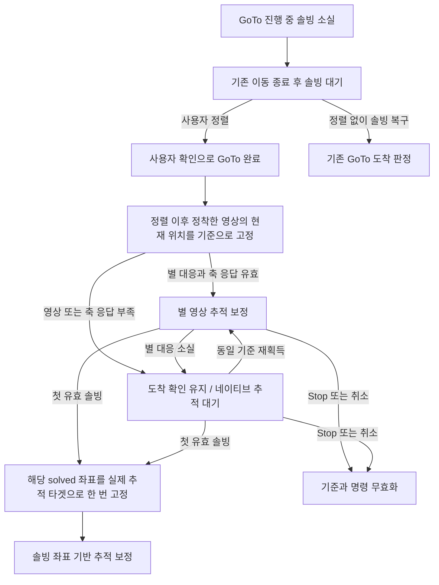

# 현재 솔빙·MFDS·전처리 설계

기준: 2026-10-10 작업 트리. 별 검출과 패턴 솔빙, 관측 승인과 포인팅 갱신을 구분한다.
검출 후보가 충분하거나 Tetra3 패턴이 일치해도 좌표를 즉시 제어에 사용할 수 있는 것은 아니다.

## 검출기와 실행 방식

현재 주 검출기는 MFDS 고정 바이너리 릴리즈다. `python/MFDS`와
`deployment/mfds.lock.json`을 통해 배포하며 MFDS 소스는 별도 저장소에서 관리한다.
기본 transport는 상주 native worker 프로세스와 전용 memfd 메모리다.
Cedar 서버나 Cedar systemd unit을 설치·기동하는 옛 설계는 현재 경로가 아니다.
`MF_DETECT_TRANSPORT=ctypes`는 명시적인 비교 모드이고 프로세스 오류 시 자동 전환하지 않는다.
[패키지 관리](../MFDS_BINARY_DISTRIBUTION_ko.md), [검출기 통합](../DETECTOR_INTEGRATION_ko.md)을 참조한다.

## 프레임 처리와 마지막 SEP 복구

카메라 RAW와 메타데이터 → MFDS 검출 → 중앙/전체 후보의 Tetra3 패턴 탐색 →
필요한 동일 관측 전처리 복구 → 광학 품질·좌표 연속성 승인 → `SuccessfulSolve` 게시 순서다.
센서 전체 공간과 표시 크롭 공간은 `solver_frame_map.py`로 변환한다.
RAW·전처리·검출 좌표·관측 시각의 대응을 유지한다.

MFDS 패키지의 검출 수준 보조 정책과 MFNavis의 **최종 SEP 솔빙 복구**는 별개다.
현재 `_solve_sep_emergency()`는 MFDS 주요 솔빙 경로 실패 뒤 동일 frame ID의
신선한 RAW에 한해 마지막 복구를 시도한다. 승인 대기 중인 MFDS 후보는 실패로
취급하지 않는다. 이동 중이거나 주요 경로가 완료되지 않은 경우 복구를 승인하지 않는다.
SEP 전처리/RAW 재시도는 추가 탐색 예산 1초를 공유하고 반복 실패는 backoff한다.
SEP 결과도 일반 광학 품질·연속성 검사를 통과해야 하며 임의의 좌표 점프를 게시하지 않는다.

## 동기·비동기 전처리

`solver_preprocess_mode=auto`가 기본, `sync`는 고정 동기 모드다.
시작과 RAW 실패 복구는 동기로 처리한다. RAW가 3프레임 연속 성공하면 비동기로 전환하고,
RAW 패턴은 풀려도 좌표 게시가 2회 연속 보류되면 다음 프레임을 동기 복구한다.
이동·광학·target pixel 변경과 정렬/캘리브레이션은 해당 이력과 generation을 초기화한다.

`LatestFrameWorker`는 실행 1개와 최신 대기 1개를 유지해 오래된 입력의 큐 누적을 막는다.
오래된 비동기 결과는 현재 프레임의 새 solve로 게시하지 않는다.
원본/전처리의 bias 보정은 대응 관측으로 학습하고 불일치나 기준 변경 시 초기화한다.

## 품질과 광학

이동 프레임 판정, false-solve 방어, `SolveContinuityGate`, optics/FOV 검증은
패턴 성공 이후의 승인 조건이다. 중앙/전체 프레임 솔빙과 centroid 왜곡 보정은 유지한다.
예전 Wide tiles·Edit exclusions UI/API·타일 복구 솔빙은 제거된 기능이며,
남아 있는 도우미 파일만으로 현재 서비스 경로에 연결됐다고 설명하지 않는다.
렌즈 측정과 활성 왜곡 프로파일은 [카메라·광학](camera_ko.md)을 따른다.

## 진단과 회귀

`utils.runtime_dir/solver_scheduling_status.json`에서 설정/실행 모드, 전환 이유,
frame ID·generation·처리 시간을 확인한다. 노출 시간, 계산 지연, 성공 관측 갱신 간격은
서로 다른 지표다. 전체 성능 비교에는 검출기 버전과 실제 실행 바이너리의 provenance를 포함한다.

- [솔버](../../python/MFNavis/solver.py), [스케줄러](../../python/MFNavis/solver_scheduling.py), [SEP 복구](../../python/MFNavis/sep_shadow.py).
- [스케줄링 검사](../../python/tests/test_solver_scheduling.py), [프레임 pairing](../../python/tests/test_solver_frame_pairing.py).
- [관측 승인](../../python/tests/test_solve_acceptance.py), [전처리 후보](../../python/tests/test_solver_preprocessed_candidates.py), [FOV 조건](../../python/tests/test_solver_optics_gate.py).

Cedar/SEP 조사·광각 타일 설계·전처리 초기 실험은 [솔빙 이력](../history/development/solver.md)에서
작성 당시의 근거로 읽는다. 현재 솔빙 실패의 마운트 동작은 [마운트 제어](mount_control_ko.md)를 따른다.

## 솔빙 실패 시 별 영상 기반 상대 추적 개발 설계

작성일: 2026-10-11. 상태: 기능 목적 확정, 통합 설계 초안, 운영 경로 미구현.

후속 작업 순서: 기본 GoTo와 추적 보정 수정이 끝난 뒤 기존 Smooth와 병합한다.
INDI 페이지 맨 아래 배치와 최소 설정 요구는
[Smooth 통합 계획](tracking_ko.md#smooth와-상대-영상-추적의-통합-계획)에 기록했다.
현재는 운영 코드·화면을 변경하지 않으며 추가 테스트·검증은 사용자 요청 시 진행한다.

솔빙이 실패하더라도 영상에서 별이 검출되면, 기준 영상의 별과 현재 영상의 별을
대응시켜 이동량을 측정하고 추적 보정에 사용한다. 짐벌 카메라가 지정한 대상을
영상에서 계속 찾아 화면의 같은 위치에 유지하는 것처럼, 여러 별의 배치를 기준으로
관측 대상의 위치 이탈을 측정한다. 관측 대상 자체가 밝게 보일 필요는 없다.

사용자가 요청한 핵심은 **별 영상에서 실제로 측정한 상대 이동량을 이용하는 것**이다.
마지막 오차와 표류 속도를 외삽하는 기존 `GuideHoldover`와 측정 근거가 다르다.
무솔빙 GoTo 대기 중 정렬을 받으면 현재 위치의 영상 추적을 시작하고, 첫 유효
솔빙 좌표를 실제 추적 타겟으로 고정해 이어가는 흐름을 요구사항으로 삼는다.
아래 내부 상태와 제어 구현은 설계안이며 운영 기본값은 아직 변경하지 않는다.

### 기능 범위와 기준점

첫 통합에는 다음 두 경로를 포함한다.

- **무솔빙 GoTo 대기 중 사용자 정렬**: 사용자 확인으로 이동 완료를 확정하고
  현재 위치에 영상 기준을 만든다. 솔빙 복구 전부터 상대 영상 오차로 추적 보정한다.
- **광학 도착 후 솔빙 소실**: 이미 확보한 솔빙 기준과 추적 타겟을 유지하면서
  영상 오차로 보정한다. 정상 솔빙 중에도 기준 별과 추적 품질을 준비한다.

정렬 없이 GoTo 도착 전 대기 중인 경우는 기존 정책을 유지한다. 별 영상만으로
원래 카탈로그 타겟에 도착했다고 판단하거나 추가 GoTo를 실행하지 않는다.

기준에는 기준 출처(사용자 정렬 또는 승인 솔빙), 같은 프레임의 별 중심점,
관측 시각, 카메라 기하, `target_pixel`, 추적 타겟과 제어 세대를 함께 저장한다.
승인 솔빙 자세는 확보된 경우에만 저장한다. **고정 영상 기준**, **마지막 승인
솔빙 기준**, **직전 유효 영상 측정**은 별도로 유지한다. 직전 프레임은 별을 찾을 위치의 예측에
사용하고, 보정 오차는 고정된 추적 타겟에 대해 계산한다. 매 프레임 현재 위치를
새 목표로 덮어써 누적 이탈이 사라지는 구현은 허용하지 않는다.

사용자 정렬 경로는 해당 위치에서 성공한 솔빙이 없어도 시작할 수 있다.
별의 영상 좌표와 카메라 기하로 로컬 기준을 만들며, 절대 RA·Dec는 미확정으로 둔다.
기존 천체 identity는 표시·사용자 의도에 남길 수 있지만 카탈로그 좌표를 현재 위치의
실측 좌표로 사용하지 않는다. 상대 보정에는 현재 장비에 유효한 축 응답이 필요하다.
별 자체가 검출되지 않거나 같은 별을 식별할 수 없으면 영상 이동량도 측정할 수 없다.

### 무솔빙 GoTo 대기 중 정렬 처리

LCD Align과 SkySafari Align 등 기존 사용자 도착 확인 입력을 공통 처리한다.
현재 구현은 `arrived_waiting_solve`에서 네이티브 추적으로 기다린다.
이번 변경은 이 대기 구간에 별 영상 기반 보정을 추가한다.

1. 정렬 입력으로 **사용자 확인에 의한 이동 완료**를 기록하고, 원래 카탈로그
   좌표를 향한 접근·미세 보정 예약을 무효화한다. 광학 도착 성공을 위조하지 않는다.
   마운트 추적은 유지하며 완료 원인은 사용자 확인으로 구분한다.
2. 물리적 이동·유한 펄스가 남아 있으면 종료와 정착을 확인한 뒤 기준을 잡는다.
   정렬 입력 이전 또는 이동 중 촬영한 프레임은 기준으로 사용하지 않는다.
3. 정렬과 정착 이후의 첫 적합한 영상에서 별 목록과 `target_pixel` 방향을
   고정한다. 기준 프레임 자체의 오차는 0이고 다음 유효 프레임부터 보정한다.
4. 별 대응이 유효하면 이 기준 위치의 이탈을 보정한다. 기준을 아직 만들지
   못했으면 사용자 완료 상태로 기다린다. 기존 기준을 잃은 뒤 다른 별밭을
   임의로 새 기준으로 잡지 않고 동일 기준 재획득·새 정렬·유효 솔빙을 기다린다.
5. 정렬과 이동 종료 이후 촬영되고 일반 승인 검사를 통과한 첫 신선한 solve의
   `pointing.aligned.solve`를 실제 추적 타겟으로 **한 번만** 고정한다.
   이후 solve는 고정된 타겟에 대한 오차 측정에 사용한다.

복구 시 원래 카탈로그 좌표로 되돌아가는 GoTo를 보내지 않는다. 첫 solve 시점의
실제 위치를 타겟으로 채택하므로 정렬 직후 영상 기준과 남아 있던 작은 위치 차이는
그 전환에서 새 기준에 흡수된다. 영상 기준의 하늘 좌표를 역산해 이전 지점으로
복귀시키는 정책은 이번 요구사항에 포함하지 않는다.

솔빙 결과가 기준 영상 생성보다 먼저 도착하면 유효성을 확인해 바로 솔빙 추적으로
전환한다. 두 결과가 동시에 도착해도 동일 제어 세대에서 타겟 고정은 한 번만 수행한다.
반복 정렬은 명시적인 새 기준 설정으로 처리하며 이전 기준과 대기 명령을 무효화한다.
사용자가 명시적으로 보정을 껐거나 Stop한 상태를 이 전환으로 해제하지 않는다.

### 현재 재사용할 수 있는 구현

| 구현 | 현재 역할 | 이번 기능에서 필요한 작업 |
|---|---|---|
| `visual_tracking.py::fit_star_pose` | 별의 일대일 대응, 모호한 대응 배제, RANSAC·SVD 회전 추정 | 실패 프레임의 검출 결과와 연결하고 품질 기준 검증 |
| `visual_tracking.py::TrackingSession.observe` | 솔빙·별 측정·예측 상태 구분과 상대 타겟 오차 계산 | 기본 GoTo/Guide 수명주기와 기준점 무효화 연동 |
| `visual_tracking.py::TrackingSession.align` | 사용자 기준과 세대 초기화 | 절대 자세가 없는 로컬 영상 기준과 절대 좌표 미확정 상태 지원 |
| `visual_tracking.py::correction_proposal` | 실측 축 응답 행렬로 진단용 펄스 제안 계산 | 운영 제어권·실행기 검사와 연결 필요; 현재 명령 송신 없음 |
| `visual_tracking_runtime.py::LiveShadow` | 동일 RAW·검출 결과 pairing과 환경 확인, 시험 기록 | 일반 운영 경로의 입력·상태 계약으로 통합 여부 결정 |
| `tracking_quality.py::StarTracker` | 기준 별 ROI 측정, 품질·시각·오차 범위 검사 | 전체 검출 결과 재사용 방식과 ROI 추적 방식 비교 |

기존 visual 경로는 `shadow` 시험이다. 별 추적 계산 코드가 존재한다는 사실과
일반 솔빙 실패 시 자동 마운트 보정이 구현됐다는 주장은 구분한다.
Smooth tracking과 기본 guide의 제어권은 [추적 제어](tracking_ko.md)를 따른다.
새 병렬 제어기를 추가하기보다 상대 측정을 기존 제어 경로에 공급하는 방향을 우선한다.

### 별 대응과 이동량 계산

1. **입력 준비**: 솔빙 성공 여부와 별개로 동일 frame ID의 검출 중심점과
   카메라 메타데이터를 받는다. 우선 MFDS 검출 결과를 재사용한다. RAW와 전처리
   좌표를 섞지 않고 왜곡 보정·회전·크롭 변환을 동일한 좌표계로 정규화한다.
2. **대응 후보 탐색**: 기준 별을 직전 유효 자세로 현재 영상에 투영하고 주변에서
   일대일 대응을 찾는다. IMU 또는 이전 속도는 탐색 위치를 예측하는 보조 정보로만
   사용하며, 영상 측정 성공으로 취급하지 않는다.
3. **오대응 제거**: 핫픽셀·잡음·포화·늘어진 별, 가까운 이중성의 모호한 대응,
   공통 이동과 맞지 않는 점을 배제한다. 광도는 노출·게인 변화의 영향을 받으므로
   별 identity의 단독 기준으로 사용하지 않는다.
4. **자세 변화 추정**: 기존 `fit_star_pose`의 회전 추정을 우선 재사용한다.
   최소 3개의 독립 대응과 충분한 영상 내 분포를 요구하고, 실제 최소 별 수는
   검증 결과로 정한다. 평행 이동뿐 아니라 화면 회전을 반영하며, 별 한 개의
   이동만으로 회전을 확정하지 않는다. 기하가 고정된 동안 임의 배율·전단으로
   오대응을 흡수하지 않는다.
5. **보정 오차 산출**: 추정 자세에서 추적 대상이 나타나야 하는 픽셀 위치와
   `target_pixel`의 차이를 구한다. 대상 주위 화면 회전은 자세 추정에 반영하지만
   회전량 자체를 두 축 마운트로 제거할 수 있다고 가정하지 않는다.
6. **품질 승인**: 대응 별 수·분포, inlier 비율, 재투영 RMSE, 측정 나이,
   프레임 간 간격, 누적 불확실성, 탐색 범위 이탈을 검사한 관측만 제어에 전달한다.

첫 버전은 정렬 후 고정한 영상 또는 마지막 솔빙 기준의 별을 유지한다. 기준 별이 시야에서 사라졌을 때
프레임 연결만으로 기준을 무제한 재생성하지 않는다. 추후 기준 영상 교체를 도입하면
원래 타겟과 절대 기준, 누적 오차 범위를 보존하는 계약을 별도로 추가한다.

### 좌표와 관측 계약

상대 영상 관측은 새 `SuccessfulSolve`가 아니다. `pointing.aligned.solve`와
`last_solve_success`를 갱신하지 않으며, 솔빙 성공 횟수에도 포함하지 않는다.
`solve_state`는 현재 포인팅의 존재 여부이므로 영상 보정 진입 조건으로 단독 사용하지 않는다.
용어는 [Positioning 계약](../ax/positioning/CONTEXT.md)을 따른다.

첫 통합은 상대 관측을 별도 측정으로 제어기에 전달한다. 화면·외부 프로토콜의
`pointing.aligned.estimate`에도 반영할지는 별도 결정하며, 반영 시 integrator가
IMU와 영상에서 같은 이동량을 중복 적용하지 않도록 관측 시각과 기준을 맞춰야 한다.

제안 관측 필드는 다음과 같다. 실제 타입과 이름은 기존 추적 계약과 맞춰 확정한다.

| 정보 | 용도 |
|---|---|
| 기준 출처·기준 frame ID·관측 frame ID·기준 솔빙 시각 | 사용자 영상 기준과 솔빙 기준 구분; 솔빙 기준이 없으면 시각은 미확정 |
| 사용자 도착 확인·확인 시각·절대 타겟 고정 여부 | 사용자 완료와 광학 관측 구분, 첫 복구 solve로 한 번만 타겟 고정 |
| 노출 구간·측정 시각·시계 세대 | 처리 완료 시각과 실제 관측 시각 구분, 오래된 결과 배제 |
| 타겟·제어·카메라·광학 세대 | 취소·새 타겟·설정 변경 이전 결과 무효화 |
| 상대 자세·타겟 픽셀 오차 | 영상 이동과 제어에 사용할 잔여 오차 표현 |
| 별 수·inlier 비율·RMSE·불확실성 | 제어 사용 여부와 품질 저하 원인 판단 |
| 측정 출처·유효 여부·거부 이유 | 솔빙, 별 영상 측정, 예측 상태 구분 |

### 상태 전환과 마운트 보정

아래 상태 이름은 설계용이며 기존 runtime 문자열 변경을 확정한 것은 아니다.

| 상태 또는 사건 | 처리 |
|---|---|
| 정상 솔빙 | 기존 솔빙 기반 보정 유지, 같은 프레임의 기준 별과 영상 품질 준비 |
| 무솔빙 GoTo 대기 중 정렬 | 사용자 완료 기록, 정착 후 현재 영상 기준 고정 및 영상 보정 시작 |
| 솔빙 사용 불가·별 추적 유효 | 기능 허용 및 실행 조건 충족 시 영상 오차로 보정 전환 |
| 솔빙 사용 불가·별 추적 불가 | 영상 보정 중지, 기존 기본 guide 실패 정책에 따름 |
| 사용자 정렬 후 첫 유효 솔빙 | 실제 solved 좌표로 타겟 한 번 고정, 영상 명령 정리 후 솔빙 보정 전환 |
| 기존 절대 타겟의 유효 솔빙 복구 | 고정 타겟 유지, 동일 관측 기준으로 영상 추정과 비교하고 절대 기준 갱신 |
| 수동 이동·새 GoTo·정렬 변경 | 이전 기준과 대기 명령 무효화, 이동·기준 변경 후 재획득 |
| Stop·취소·추적 Off·한계 정지 | 보정 해제, 이후 별 재검출·솔빙 복구만으로 재시작 금지 |
| 연결·광학·센서 모드·pier side 변경 | 관련 기준과 축 응답 유효성 재검사 전 명령 금지 |

영상 오차를 펄스로 바꿀 때는 검증된 축 응답 행렬 또는 기존의 검증된 각도 변환을
사용한다. 픽셀에서 오른쪽으로 이동했다는 이유만으로 동·서 방향을 하드코딩하지 않는다.
카메라 방향, 반전, 마운트 종류와 pier side가 반영된 현재 장비 응답이어야 한다.
응답 행렬 `J`를 쓰는 경우 잔여 픽셀 오차 `e`에 대해 `J × pulse = -e`를 풀고,
확인된 최소 보정량·최대 펄스·실행 간격을 적용한다. 특이하거나 불안정한 행렬은 거부한다.

동일 시점의 보정 소유자는 하나다. 영상 측정으로 보정하는 동안 같은 오차에
기본 PID, `GuideHoldover`, smooth active가 중복 펄스를 보내지 않게 한다.
새 영상 측정은 실행된 펄스의 결과를 이미 포함하므로 이전 펄스 이동량을 다시 빼거나
이전 오차를 재적분하지 않는다. 첫 통합은 진행 중 펄스 종료 이후의 신선한 관측으로
다음 보정을 결정하며, 펄스와 겹친 노출의 허용 여부는 기존 시각 계약을 따른다.

별 추적까지 실패해 기본 guide의 holdover로 돌아갈 때는 제어 전환 경계의 잔량·
실행 펄스 기록을 맞춘다. 이를 일관되게 넘길 수 없으면 추가 펄스를 대기한다.
사용자 정렬의 로컬 영상 기준만 있고 유효한 holdover 기준이 없으면 네이티브
추적으로 기다린다. 과거 GoTo의 카탈로그 오차나 이동 전 표류 기록을 재사용하지 않는다.
이 기능의 관측 품질 제한을 기존 기본 guide의 무기한 솔빙 대기 정책에 전파하지 않는다.

### 솔빙 복구와 화면 표시

일반 품질·연속성 검사를 통과한 새 solve가 복구 기준이다. 사용자 정렬 경로는
위의 첫 solve 타겟 고정 정책을 따른다. 절대 좌표가 없던 로컬 기준과 RA·Dec의
차이를 좌표 점프로 판정하지 않는다. 이미 절대 타겟이 있던 경로는 가능한 경우 같은 프레임의
영상 추정과 비교하고, 서로 다른 시각이면 그 사이 이동을 고려한다. 차이가 작으면
절대 기준과 별 목록을 갱신하고 제어기 잔량을 맞춰 정상 보정으로 전환한다.
차이가 크면 대기 명령을 무효화하고 기존 관측 승인·광학 복구 정책을 거친다.
상대 추적 성공만으로 큰 좌표 점프를 승인하거나 광학 도착을 선언하지 않는다.

LCD와 웹에서는 `솔빙 추적`, `별 영상 추적`, `솔빙 대기`를 구분하는 표시를 제안한다.
별 영상 추적 중에도 마지막 **솔빙** 성공 시각과 마지막 **영상 추적** 성공 시각을
별도로 표시한다. 기존 도착 표시의 광학 유효시간을 영상 측정으로 연장하지 않는다.
사용자 정렬 후에는 `사용자 확인 완료 · 별 영상 추적`으로 이동 완료와 보정 수단을
함께 표시한다. 영상 기준을 아직 확보하지 못하면 `사용자 확인 완료 · 영상 대기`로
표시하고, 첫 solve 채택 후 `솔빙 추적`으로 전환한다. 완료 원인을 광학 도착과
별도로 저장하여 `optical_arrival_confirmed`를 영상 추적 시작 조건으로 요구하지 않는다.

기록에는 기준·현재 frame ID, 측정 출처, 상대 이동과 타겟 오차, 별 수·RMSE,
거부 이유, 보정 소유자, 요청·수락된 펄스와 전환 사유를 남긴다.
영상 이동량의 정확도와 실제 마운트 보정의 효과를 분리해서 평가한다.

### 구현 순서와 수락 기준

1. 솔빙 실패 프레임에서도 검출 중심점과 메타데이터를 얻는 입력 계약을 정하고,
   기존 자세 추정 코드를 재사용해 상대 측정과 진단 기록을 연결한다.
2. 기록 영상과 인공 변환으로 이동량·회전·거부 조건을 검증한다. 솔빙 성공 구간을
   가려서 실패 상황을 재현하고, 숨겨 둔 solve와 상대 추정을 비교한다.
3. 실제 영상에서 명령을 보내지 않는 shadow 검증으로 품질 임계값과 처리 지연을 정한다.
4. 무솔빙 정렬 완료→로컬 영상 보정→첫 solve 타겟 고정을 연결하고, 기본 guide와의
   제어권 전환, 취소·복구·펄스 회계를 검증한 뒤 운영 보정에 연결한다.
5. 실장비에서 펄스 전후 영상 오차 감소와 솔빙 복구 시 전환을 확인하고 기준 문서를 갱신한다.

| 검증 상황 | 수락 기준 |
|---|---|
| 알려진 이동·회전의 인공 프레임 | 정한 오차 범위 안에서 타겟 이탈 복원, 축 방향 확인 |
| 무솔빙 GoTo 대기 중 LCD 또는 SkySafari 정렬 | 사용자 완료 기록, 정착 후 기준 확보 및 영상 보정, 원래 타겟 재이동 없음 |
| 현재 위치에서 성공한 solve 없이 정렬 | 로컬 기준으로 상대 추적, 절대 좌표·광학 도착 위조 없음 |
| 정렬 시 별 부족 또는 축 응답 무효 | 완료 확인 유지, 조건 확보 전 영상 펄스 없음 |
| 정렬 이후 첫 유효 solve와 후속 solve | 첫 실제 좌표로 한 번 고정, 후속 프레임마다 재타겟하지 않음 |
| 정렬 전·이동 중·펄스 종료 전 프레임의 지연 도착 | 영상 기준과 복구 타겟에 채택하지 않음 |
| 기준 영상과 solve 동시 도착·반복 정렬 | 한 세대에 한 번 전환, 이전 명령 실행 없음 |
| 일부 별 소실·가짜 점·모호한 이중성 | 잘못된 대응 제거 또는 측정 거부, 잘못된 보정 없음 |
| 구름·흔들림·노출 변화·별 부족 | 품질 저하 이유 기록, 무효 관측으로 영상 펄스 생성 안 함 |
| 동일 프레임 반복·역순·긴 간격 | 중복 소비와 오래된 결과 적용 없음 |
| 솔빙과 영상 추적 전환 반복 | 타겟 유지, 동일 잔량·펄스 중복 적용 없음 |
| 회전·반전·왜곡·pier side 변경 | 올바른 좌표 변환 또는 기준 무효화 |
| 취소·수동 이동·한계 정지와 결과 도착 경합 | 이전 세대 명령 거부, 금지된 자동 재시작 없음 |
| 장기 실패 후 솔빙 복구 | 영상 추정 오차 측정, 절대 기준 갱신과 기존 복구 정책 준수 |

관측 승인·프레임 pairing, visual tracking·smooth handover, 기본 guide lifecycle과
holdover 회귀 검사를 실제 변경 범위에 맞춰 선택한다. 품질 수치와 펄스 제한은
기존 시험 코드의 기본값을 그대로 운영 보증으로 삼지 않고 기록 재생·실장 결과로 확정한다.

남은 결정은 기능 설정의 기본값, 영상 추적의 최대 불확실성·관측 간격·최소 별 수,
일반 포인팅 estimate 및 외부 좌표 반영 여부, GoTo와 관계없는 독립 영상 고정의
후속 지원 범위다. 무솔빙 GoTo 대기 중 사용자 정렬에 의한 영상 보정은 첫 통합 범위다.
운영 기능은 아직 구현하지 않았다. 독립 테스트 코드와 합성·저장 RAW 재생 결과는
[오프라인 성능 평가](../mf_report/visual_fallback_benchmark_20261011_ko.md)에 정리했다.
10월 10일 구름 시험은 상태 로그만 확인되어 해당 영상의 상대 이동 재생은 수행하지 못했다.
별이 적고 희미한 조건의 후속 실험에서는 기준 별 ROI 검사, 공간적으로 분산된
3개 이상의 대응, 최대 3프레임 누적과 관측 지연 표시를 추가했다.
[약한 별 시험 결과](../mf_report/weak_star_fallback_benchmark_20261011_ko.md)는 테스트용
후보 구현이며 운영 제어 경로나 품질 임계값을 변경한 것은 아니다.
